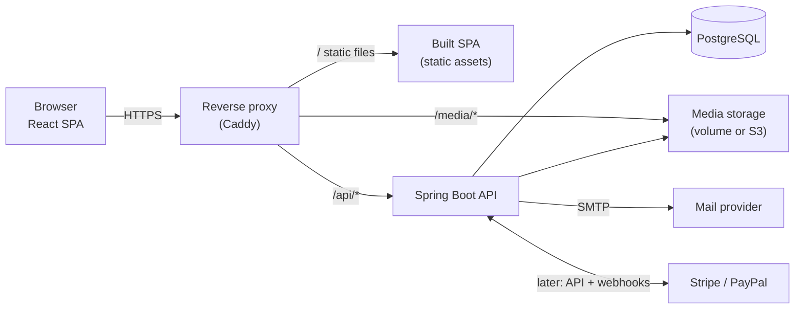
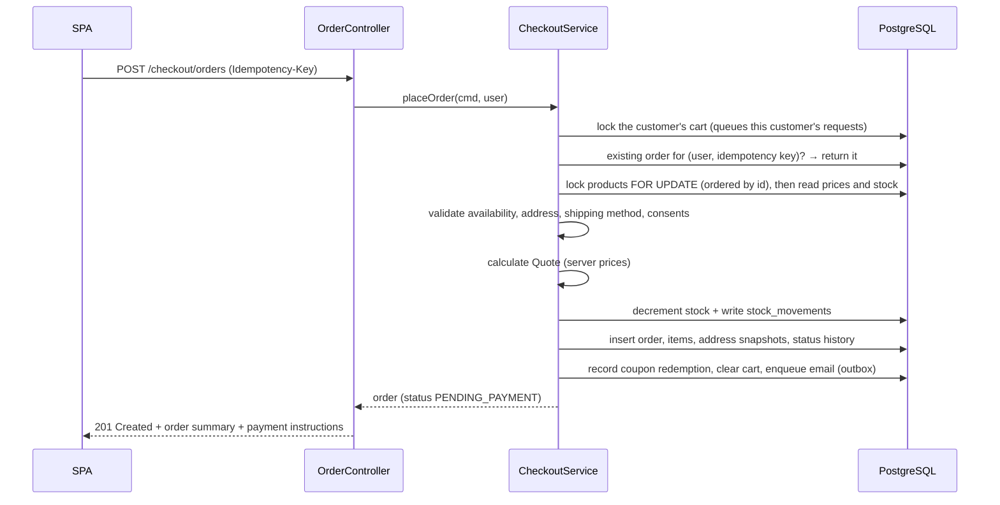
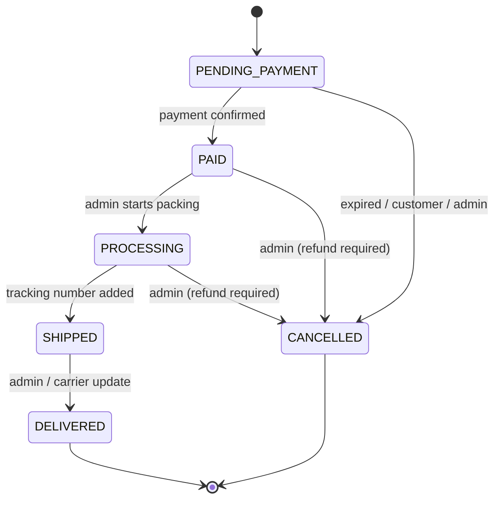

# PW Aquatics — Application Architecture

> Status: **Proposal — awaiting owner approval.** Nothing in this document is
> implemented yet. Related documents: [DATABASE.md](DATABASE.md),
> [API.md](API.md), [ROADMAP.md](ROADMAP.md).

---

## 1. Requirements analysis

### 1.1 What we are building

A premium, fully custom online shop for ornamental freshwater shrimp and other
aquatic invertebrates (snails, crayfish, crabs, mussels). The product is **live
animals**, which drives several requirements a generic shop would not have:
weather-dependent shipping, limited dispatch days, stock that can shrink without
a sale (animal losses), and species that may legally not be traded.

### 1.2 Functional scope

| Area | Capabilities |
|---|---|
| Public site | Homepage, About, Gallery, Contact form, legal pages |
| Catalog | Products with species, category, colours, grade, descriptions, images, prices, stock, availability |
| Filtering | Species, colour, grade, price range, availability (+ category, text search, sorting) |
| Cart | Persistent server-side cart for guests and customers; merged on login |
| Checkout | Address, shipping method, coupon, order review, order placement |
| Accounts | Register, login/logout, email verification, password reset, profile, saved addresses, order history, order status, parcel tracking |
| Admin | Dashboard, sales statistics, products, taxonomy, inventory, orders, tracking numbers, coupons, gallery, contact messages |
| Payments (later) | Stripe (cards, Apple Pay, Google Pay), PayPal. Bank transfer (Vorkasse) as the first, manual method |

### 1.3 Non-functional requirements

- **Security first:** server is the single source of truth for prices, stock,
  discounts, totals and order state. Role-based access. No card data ever
  touches our servers.
- **Correctness under concurrency:** stock must never go negative; an order is
  placed exactly once even if the request is retried.
- **Performance:** catalog pages should feel instant (LCP < 2.5 s on 4G),
  optimised responsive images.
- **Maintainability:** modular code, migrations, typed API contract, tests.
- **Compliance:** the shop presumably targets Germany / the EU — GDPR, German
  e-commerce rules (Impressum, price display incl. VAT, right of withdrawal,
  "zahlungspflichtig bestellen" button), invoice retention.
- **Accessibility:** WCAG 2.2 AA as the target.

### 1.4 Assumptions (to be confirmed — see §12)

1. Primary market is Germany, currency **EUR**, prices displayed **gross** (incl. VAT).
2. UI language English first (default), German second; the code base is i18n-ready from day one.
3. One shop, one warehouse, one currency. No marketplace / multi-vendor.
4. Expected scale is small to medium (hundreds of products, up to a few thousand
   orders/month). A single backend instance is enough; the design still allows
   horizontal scaling.
5. Customer accounts are required for checkout in the MVP; the schema allows
   guest checkout later.

---

## 2. System overview



Key decisions:

- **Same origin.** The SPA and the API are served from one domain
  (`/` and `/api`). This keeps auth cookies simple (`SameSite=Lax`, no CORS in
  production) and is the main reason we use a reverse proxy in front of both.
- **Modular monolith.** One deployable Spring Boot application with strict
  internal module boundaries. Microservices would add operational cost with no
  benefit at this scale; clean modules keep the option to split later.
- **Server-rendered nothing, server-computed everything.** The React app
  renders; the API decides. Every price, total, discount, stock check and
  status transition happens in the backend.

---

## 3. Technology stack

Exact versions are pinned in Phase 0 (latest stable at that time). Targets:

| Layer | Choice | Notes |
|---|---|---|
| Language (BE) | Java 25 (LTS) | Records, sealed types, pattern matching, virtual threads |
| Framework | Spring Boot 4.x | Web MVC, Security, Data JPA, Validation, Mail, Actuator |
| Persistence | Hibernate (via Spring Data JPA), Flyway | `ddl-auto=validate`; schema only through Flyway |
| Database | PostgreSQL 18 | `citext`, `pg_trgm` extensions |
| Sessions | Spring Session JDBC | Server-side sessions stored in PostgreSQL |
| API docs | springdoc-openapi | OpenAPI spec is the contract for the frontend |
| Mapping | MapStruct | DTO ↔ entity mapping, no entities in API responses |
| Rate limiting | Bucket4j | Login, registration, contact, coupon checks |
| Images | Thumbnailator / ImageIO + WebP | Resize, re-encode, strip EXIF on upload |
| Build (BE) | Gradle (Kotlin DSL) | Maven is equally fine; one choice, consistently |
| Language (FE) | TypeScript 6 (strict) | Stays on 6.x until typescript-eslint supports TypeScript 7 |
| UI | React 19 + Vite 8 | SPA |
| Routing | React Router 8 (data mode) | Not framework mode; lazy-loaded route chunks |
| Server state | TanStack Query | Caching, invalidation, loading/error states |
| Forms | React Hook Form + Zod | Client validation for UX only — server is authoritative |
| Styling | Tailwind CSS 4 | Design tokens via `@theme` |
| UI primitives | Radix UI (headless) | Accessible dialogs, menus, popovers |
| Motion | CSS transitions + `motion` (sparingly) | Respect `prefers-reduced-motion` |
| API types | `openapi-typescript` | Generated from the backend OpenAPI spec |
| i18n | react-i18next | English default, German available |
| Charts (admin) | Recharts | |
| Testing | JUnit 5, Testcontainers, MockMvc; Vitest, Testing Library, Playwright | |
| Infra | Docker, Docker Compose, Caddy, GitHub Actions | |

---

## 4. Repository layout

```
wakupwirbellose/                 # repository name (brand: PW Aquatics)
├── AGENTS.md / CLAUDE.md        # Instructions for coding agents
├── README.md
├── docker-compose.yml           # Full local stack
├── docker-compose.prod.yml      # Production overrides
├── .env.example                 # Every variable documented, no real secrets
├── docs/                        # Architecture, database, API, roadmap, ADRs
├── infra/
│   ├── caddy/Caddyfile
│   └── postgres/                # init scripts (extensions), backup scripts
├── backend/
│   ├── build.gradle.kts
│   ├── Dockerfile
│   └── src/
│       ├── main/java/com/pwaquatics/shop/...
│       ├── main/resources/
│       │   ├── application.yml
│       │   ├── db/migration/          # Flyway migrations (all environments)
│       │   ├── db/seed-dev/           # Dev-only seed data
│       │   └── templates/mail/        # Email templates
│       └── test/java/...
└── frontend/
    ├── package.json
    ├── Dockerfile
    ├── vite.config.ts
    └── src/...
```

---

## 5. Backend architecture

### 5.1 Modules (package-by-feature)

Root package: `com.pwaquatics.shop` (to be confirmed).

| Module | Responsibility |
|---|---|
| `common` | Shared kernel: `Money`, error handling, base entity, pagination, clock, ID generation |
| `security` | Spring Security config, session/CSRF setup, current-user resolution, rate limiting |
| `identity` | Users, registration, login, email verification, password reset, roles |
| `customer` | Profile, saved addresses, account deletion/anonymisation |
| `catalog` | Products, variants, species, categories, colours, grades, images, search & filters |
| `inventory` | Stock levels, reservations, stock movements, low-stock alerts |
| `cart` | Guest and customer carts, merge on login |
| `pricing` | Price, VAT, coupon and shipping calculation (pure domain logic) |
| `coupon` | Coupon definitions, validation, redemptions |
| `shipping` | Shipping methods, countries, dispatch-day rules, shipping pause |
| `settings` | Shop-wide key/value settings (e.g. the shipping pause), read by other modules |
| `order` | Checkout, order placement, order lifecycle, status history |
| `fulfilment` | Shipments and tracking numbers |
| `payment` | Payment abstraction; bank transfer now, Stripe/PayPal later; webhooks |
| `notification` | Transactional email via an outbox |
| `media` | Image upload, processing, storage abstraction |
| `content` | Gallery, contact messages |
| `admin` | Dashboard and sales statistics (read models); admin controllers live in their feature modules |
| `audit` | Audit log of admin and security-relevant actions |

### 5.2 Layering inside a module

```
catalog/
├── api/            # @RestController, request/response DTOs (records), mappers
├── application/    # Use-case services (@Service, @Transactional), commands, queries
├── domain/         # Entities, value objects, domain rules, domain events
└── infrastructure/ # Spring Data repositories, specifications, external adapters
```

Rules:

1. Controllers are thin: validate input (Jakarta Validation), call one
   application service, map the result. No business logic in controllers.
2. Transactions start in the application layer, never in controllers.
3. Entities never leave the module boundary and never appear in API responses.
4. Modules talk to each other through application services or domain events,
   never by reaching into another module's repositories.
5. Business rules live in domain objects or dedicated domain services (e.g.
   `Order.transitionTo(...)`, `PriceCalculator`), so they are unit-testable
   without Spring.
6. Module boundaries are enforced by an ArchUnit (or Spring Modulith) test.

### 5.3 Cross-cutting concerns

- **Errors:** a global `@RestControllerAdvice` produces RFC 9457 Problem Details
  with a stable machine-readable `code` (see [API.md](API.md#error-format)).
- **Validation:** Jakarta Bean Validation on all request DTOs; domain invariants
  enforced again inside the domain model.
- **Money:** `long` minor units (cents) + currency, wrapped in a `Money` value
  object. Never `double`. Rounding mode `HALF_UP` at a single, documented place.
- **Time:** all timestamps `Instant` / `timestamptz` in UTC. Business rules that
  depend on the calendar (dispatch days) use `Europe/Berlin` via an injected `Clock`.
- **IDs:** UUIDv7 generated by the application (time-ordered, non-guessable).
  Public URLs use slugs (products) or order numbers (orders).
- **Optimistic locking:** `@Version` on mutable aggregates (products, orders, coupons).
- **Domain events:** Spring application events, published after commit
  (`@TransactionalEventListener`), e.g. `OrderPlaced` → send confirmation email.
- **Outbox:** emails are written to an `outbox_messages` table inside the business
  transaction and sent by a scheduled worker with retry. A crashed SMTP call
  never loses or duplicates an order confirmation.
- **Scheduling:** `@Scheduled` jobs with ShedLock (safe if we ever run >1 instance):
  outbox dispatch, expire unpaid orders, purge expired carts and tokens.
- **Observability:** Actuator health/readiness, structured JSON logs with a request
  ID, Micrometer metrics. No personal data in logs.
  The mail health check is disabled on purpose: email goes through the retrying
  outbox, so an SMTP outage must not mark the API unhealthy.
- **Configuration:** `application.yml` with profile overrides (`dev`, `test`, `prod`);
  every secret comes from environment variables.

### 5.4 Core domain flows

#### Price calculation (single source of truth)

The `pricing` module exposes one function used by the cart, the checkout quote
and order placement:

```
Quote = calculate(lines[variantId, qty], shippingMethod, destinationCountry, coupon?)
  1. Load current variant prices from DB (client prices are never read)
  2. subtotal   = Σ unit_price × qty
  3. discount   = coupon rules (validated: active, dates, limits, minimum order)
  4. shipping   = method price, or 0 if free-shipping threshold / coupon applies
  5. total      = subtotal − discount + shipping
  6. tax        = VAT contained in the gross total, per tax rate, discount
                  allocated proportionally across lines
```

Prices are **gross** (VAT-inclusive), as required for B2C display in Germany.
The VAT amount is derived for invoices and reporting.

#### Order placement



All of this is a single database transaction. The cart row is locked first, so a
double click or a retry of the same customer waits and then finds the order by its
idempotency key. Products are locked in a deterministic order to avoid deadlocks,
and prices and stock are read only after that lock. A conditional update
(`... SET stock_units = stock_units - :n WHERE id = :id AND stock_units >= :n`)
is the final guard against overselling. The total the customer saw is compared with
the server's (`PRICE_CHANGED`); the checkout never adjusts a cart on its own
(`CART_CHANGED` sends the customer back to the cart).

Module roles: `order` orchestrates; `cart` hands out the locked cart lines
(`CartCheckout`); `catalog` owns prices and the stock balance (`CatalogLookup`,
`CatalogStock`); `inventory` writes the stock ledger; `shipping` decides methods,
prices and dispatch dates; `payment` supplies the bank-transfer instructions;
`pricing` adds everything up.

**Stock strategy:** stock is **decremented when the order is placed**, not when
it is paid. Unpaid orders expire (bank transfer: configurable, e.g. 7 days;
card payment: e.g. 60 minutes) and their stock is returned automatically. For
live animals this is the right trade-off: we never sell an animal twice.

#### Order lifecycle



`payment_status` is tracked separately (`UNPAID`, `PAID`, `PARTIALLY_REFUNDED`,
`REFUNDED`, `FAILED`) so refunds do not distort the fulfilment state. Every
transition goes through `Order.transitionTo()`, which rejects illegal
transitions and appends to `order_status_history`. Cancelling an order that has
not shipped returns stock.

#### Cart

- A guest gets an opaque random cart token in an `HttpOnly` cookie; only its
  SHA-256 hash is stored.
- A logged-in customer has exactly one cart linked to the user.
- After login, the first cart request that carries both the session and the
  guest cookie merges the guest cart into the customer cart (quantities summed,
  capped at available stock), deletes the guest cart and clears the cookie.
  Doing this in the cart module keeps `identity` free of any cart knowledge.
- The cart stores only `variant_id` and `quantity`. Prices, totals and
  availability are recalculated on every read from the catalog
  (`CatalogLookup`) and the `pricing` module. A quantity above the available
  stock is lowered and reported as a warning; a product that cannot be bought
  right now stays visible but is excluded from the totals.
- The cart does not reserve stock. Stock is taken when the order is placed (Phase 5).
- Every cart is loaded with a row lock, so parallel requests for the same cart
  run one after the other. Expired guest carts are removed by a daily job.

#### Products, variants and stock

- A **product** is one sellable animal line, e.g. *Neocaridina davidi
  "Blue Dream", grade High*. It carries species, category, colours, grade,
  descriptions and images.
- A **variant** is a pack size of that product with its own price and SKU,
  e.g. "1 animal", "10 animals". `pack_size` says how many animals it consumes.
- **Stock is held on the product, in animals** (`stock_units`). Buying one
  "10 animals" variant consumes 10 units. This avoids the classic problem of
  singles and groups coming from the same tank but having separate stock.
- Availability is derived: `IN_STOCK`, `LOW_STOCK`, `COMING_SOON`
  (`available_from` set and no stock), `OUT_OF_STOCK`.

### 5.5 Payment architecture (implemented later, designed now)

```
PaymentProvider (interface)
├── BankTransferProvider   # MVP: shows bank details, admin marks paid
├── StripeProvider         # Payment Element: cards, Apple Pay, Google Pay
└── PayPalProvider         # PayPal Orders API
```

- The browser talks to Stripe/PayPal directly through their hosted
  components (Stripe Elements / PayPal JS SDK). **Card data never touches our
  servers**, which keeps us in the lightest PCI DSS scope (SAQ A).
- We create the PaymentIntent / PayPal order server-side **from the stored
  order total**, never from a client amount.
- Payment is confirmed **only through verified webhooks** (signature check),
  never through a browser redirect. Webhook events are stored with a unique
  `(provider, event_id)` to make processing idempotent.
- Apple Pay and Google Pay come "for free" via the Stripe Payment Element
  (Apple Pay needs domain verification).

### 5.6 Security architecture

| Concern | Approach |
|---|---|
| Authentication | Email + password; login requires a verified email address. Server-side session (Spring Session JDBC, 14 days idle timeout), cookie `HttpOnly`, `Secure`, `SameSite=Lax`. Session ID and CSRF token rotated on login. The session holds only the user id and role. Password change/reset and account deletion end the user's other sessions. |
| Why sessions, not JWT | Same-origin SPA; sessions are revocable instantly (logout, password change, admin lock), nothing sensitive is in browser storage, and Spring Security supports them natively. |
| CSRF | Spring Security CSRF with cookie-to-header pattern (`XSRF-TOKEN` cookie → `X-XSRF-TOKEN` header) for all state-changing requests. |
| Passwords | `DelegatingPasswordEncoder` with Argon2id; hashes carry an algorithm prefix and are upgraded on login if the algorithm changes. 10–128 characters, no composition rules, a small deny-list of obvious passwords. A check against a breached-password service is a possible later addition. |
| Authorisation | Roles `CUSTOMER`, `ADMIN`. URL rules (`/api/v1/admin/**` → `ADMIN`) **and** method security (`@PreAuthorize`) on admin services. Ownership checks on every customer resource (no IDOR). |
| Brute force | Rate limiting per IP and per email address on login; per IP on registration, password reset and the contact form; per user on password confirmations. 15-minute account lock after 10 wrong passwords in a row, reported as a rate limit so it does not reveal that the account exists. |
| Account enumeration | Registration, login, password-reset and email-change responses do not reveal whether an email exists; "not verified" and "locked by an admin" are only shown after the correct password. A dummy hash comparison keeps login timing similar for unknown addresses. |
| Input | Bean Validation on all DTOs; size limits on everything; Markdown in descriptions rendered with a sanitiser. |
| Uploads | Admin only; size limit; MIME type detected from content, not the filename; images re-encoded (strips EXIF and payloads); random storage keys. |
| Headers | HSTS, CSP (no inline scripts), `X-Content-Type-Options`, `Referrer-Policy`, `frame-ancestors 'none'`. Set by Caddy and Spring Security. |
| Secrets | Environment variables only; `.env` git-ignored; `.env.example` documents them. |
| Payment data | Never stored. We keep only provider references and status. |
| Admin hardening | Audit log of every admin write; TOTP two-factor auth for admins (Phase 10). |
| Dependencies | Dependabot, OWASP dependency check / `npm audit` in CI. |
| Privacy | Minimal personal data; self-hosted fonts (no Google Fonts CDN); no tracking without consent; only strictly necessary cookies; account deletion anonymises the user while keeping legally required order records. Scheduled jobs remove data without a retention duty: email text right after sending, outbox rows after 30 days, audit IP addresses after 90 days, contact messages after a year (`app.retention.*`). Newsletter consent changes are recorded in the audit log. Inventory, legal bases and periods: docs/DATABASE.md §6. |

---

## 6. Frontend architecture

### 6.1 Principles

1. **Components render; the server decides.** Components never compute prices,
   totals, discounts, VAT, stock or order status. They display what the API
   returns. Client-side validation exists only for fast feedback.
2. **Feature folders.** Code is grouped by feature, not by file type.
3. **Server state lives in TanStack Query**, not in a global store. There is
   almost no client-only global state (UI preferences, cookie consent).
4. **Typed API contract** generated from the backend OpenAPI spec.
5. **Accessible and fast by default:** semantic HTML, keyboard support,
   responsive images, lazy-loaded routes.

### 6.2 Source structure

```
frontend/src/
├── main.tsx
├── app/
│   ├── router.tsx               # Route tree, lazy route modules
│   ├── providers.tsx            # QueryClient, i18n, auth, toasts
│   ├── layouts/
│   │   ├── PublicLayout.tsx     # Header, footer, cart drawer
│   │   ├── AccountLayout.tsx    # Account sidebar navigation
│   │   └── AdminLayout.tsx      # Admin shell (separate chunk)
│   └── guards/
│       ├── RequireAuth.tsx
│       └── RequireAdmin.tsx
├── lib/
│   ├── api/
│   │   ├── client.ts            # fetch wrapper: credentials, CSRF header, Problem Details
│   │   ├── schema.d.ts          # GENERATED from OpenAPI — do not edit
│   │   └── queryKeys.ts
│   ├── format/                  # Intl formatters: money, dates, units
│   ├── i18n/
│   └── seo/                     # <title>/meta helpers, JSON-LD builders
├── components/
│   ├── ui/                      # Design system primitives
│   │   ├── Button.tsx, Input.tsx, Select.tsx, Checkbox.tsx, Badge.tsx
│   │   ├── Dialog.tsx, Drawer.tsx, Toast.tsx, Tooltip.tsx
│   │   ├── Skeleton.tsx, Spinner.tsx, EmptyState.tsx
│   │   ├── Price.tsx            # Formats a Money object — no arithmetic
│   │   ├── ResponsiveImage.tsx  # srcset/sizes, lazy, blur-up placeholder
│   │   └── Pagination.tsx
│   └── layout/
│       ├── Header.tsx, Footer.tsx, Navigation.tsx, MobileMenu.tsx
│       ├── Container.tsx, Section.tsx
│       └── CookieConsent.tsx
├── features/
│   ├── home/        pages/HomePage, components/{Hero, FeaturedProducts, SpeciesShowcase, CareTeaser}
│   ├── catalog/
│   │   ├── api/                 # useProducts, useProduct, useFacets, useTaxonomy
│   │   ├── pages/               # ShopPage, ProductPage, SpeciesPage
│   │   └── components/
│   │       ├── ProductGrid.tsx, ProductCard.tsx
│   │       ├── FilterPanel.tsx, FilterChips.tsx, PriceRangeFilter.tsx, SortSelect.tsx
│   │       ├── ProductGallery.tsx, ProductInfo.tsx, VariantSelector.tsx
│   │       ├── AvailabilityBadge.tsx, GradeBadge.tsx, ColourSwatch.tsx
│   │       └── SpeciesCareTable.tsx
│   ├── cart/        api/, components/{CartDrawer, CartLine, CartSummary, CouponForm}, pages/CartPage
│   ├── checkout/    api/, pages/{CheckoutPage, OrderConfirmationPage}, components/{AddressStep, ShippingStep, ReviewStep, OrderSummary}
│   ├── auth/        api/, pages/{Login, Register, ForgotPassword, ResetPassword, VerifyEmail}
│   ├── account/     api/, pages/{Overview, Orders, OrderDetail, Addresses, Profile}, components/{OrderStatusTimeline, TrackingCard, AddressForm}
│   ├── content/     pages/{AboutPage, GalleryPage, ContactPage, LegalPage}, components/{GalleryMasonry, Lightbox, ContactForm}
│   └── admin/
│       ├── dashboard/   KPI cards, sales chart, low-stock list, recent orders
│       ├── products/    list, editor, variant table, image manager
│       ├── taxonomy/    species, categories, colours, grades
│       ├── inventory/   stock table, adjustment dialog, movement history
│       ├── orders/      list with filters, detail, status actions, shipment form
│       ├── coupons/     list, editor, redemptions
│       ├── customers/   list, detail
│       ├── content/     gallery manager, contact inbox
│       └── settings/    shipping methods, shipping pause
├── hooks/                       # Generic hooks (useMediaQuery, useDebounce)
└── styles/
    └── index.css                # Tailwind entry + @theme design tokens
```

Each feature exposes its pages and hooks through an `index.ts`; features import
from each other only through those entry points.

### 6.3 Routes

| Path | Page | Access |
|---|---|---|
| `/` | Home | public |
| `/shop` | Shop (filters in URL query string) | public |
| `/shop/:categorySlug` | Shop pre-filtered by category | public |
| `/products/:slug` | Product detail | public |
| `/species/:slug` | Species profile with care data | public |
| `/about`, `/gallery`, `/contact` | Content | public |
| `/legal/:page` | imprint, privacy, terms, withdrawal, shipping | public |
| `/cart` | Cart | public |
| `/checkout` | Checkout | customer |
| `/checkout/confirmation/:orderNumber` | Confirmation | customer |
| `/login`, `/register`, `/forgot-password`, `/reset-password`, `/verify-email` | Auth | public |
| `/account`, `/account/orders`, `/account/orders/:orderNumber`, `/account/addresses`, `/account/profile` | Account | customer |
| `/admin/**` | Admin panel (lazy chunk) | admin |

Filters live in the URL (`/shop?species=neocaridina-davidi&colour=blue&grade=high&availability=in-stock&minPrice=500`)
so results are shareable, bookmarkable and survive reloads.

### 6.4 Data flow

```
Page → feature hook (useProducts) → TanStack Query → api client → /api/v1/...
                                           ↑
                     mutations invalidate query keys (cart, account, admin lists)
```

- `api/client.ts` always sends `credentials: 'include'`, attaches the CSRF
  header, and turns Problem Details into a typed `ApiError`.
- Mutations that change the cart return the full recalculated cart, which is
  written straight into the query cache.
- Auth state comes from `GET /auth/me`; guards wait for it before rendering.

### 6.5 Design system

Brand: **PW Aquatics**. Direction: *clean, light and premium* — white
space, soft water-blue tints and the logo's baby blue as the accent; closer to a
design-led studio than a pet-supply store. Tokens live in
`frontend/src/styles/index.css`.

- **Logo:** official artwork in `frontend/public/brand/` (mark, wordmark,
  stacked lockup), rendered via `components/layout/Brand.tsx` with unmodified
  shapes. Brand colour `#88C0DB`.
- **Typography:** *Outfit* (light weights) for headings, echoing the geometric
  logo wordmark; *Inter* for UI and body text. Scientific names always in
  italics. Fonts are **self-hosted** (WOFF2, `font-display: swap`) — loading
  Google Fonts from their CDN is a GDPR problem in Germany.
- **Colour tokens:** white `surface`, light tints `mist` (`#F5FAFD`) and `ice`
  (`#E8F3F9`), navy `ink` (`#0F2533`) for text and the footer, and a
  `brand-50…900` baby-blue scale around the logo colour (`brand-400`).
- **Contrast rules:** `brand-400` is only 2:1 on white, so it is never used for
  text or as the only boundary of a control. It is used for fills, illustrations,
  the logo and accent buttons with navy text (8:1). Brand-coloured text uses
  `brand-700` (5.9:1) or darker; input borders use `line-strong` (3.2:1).
- **Light theme only** (brand decision); no dark mode planned for v1.
- **Spacing:** 4 px base scale, generous section padding (96–160 px on desktop),
  max content width ~1280 px, 12-column grid.
- **Product card:** 4:5 image on a neutral background, second image cross-fades
  on hover, display-font product name, italic scientific name, small grade badge,
  colour swatches, price ("from €x" when several pack sizes), subtle
  availability dot. No clutter, no star-burst badges.
- **Photography rules:** consistent background and lighting, macro shots, one
  aspect ratio per context, minimum 2000 px originals.
- **Motion:** 150–300 ms ease-out transitions, gentle fade/slide-in on scroll,
  image hover zoom ≤ 1.03. Everything disabled under `prefers-reduced-motion`.
- **Components** are built in `components/ui` with variants (e.g. `cva`) so pages
  never invent one-off styles.

### 6.6 SEO and performance

- A client-rendered SPA is weak for SEO, which matters for a shop. Plan:
  per-route `<title>`/meta (React 19 metadata support), JSON-LD `Product` and
  `BreadcrumbList`, backend-generated `sitemap.xml`, and **prerendering of
  public catalog pages** in Phase 10 (see risk R3).
- Responsive images: backend generates WebP sizes (e.g. 400/800/1200/2000 px);
  `ResponsiveImage` uses `srcset` + `sizes`, lazy loading below the fold,
  explicit width/height to avoid layout shift.
- Route-level code splitting; the admin panel is never downloaded by shoppers.

---

## 7. Infrastructure

### 7.1 Docker Compose services

| Service | Image | Purpose | Dev | Prod |
|---|---|---|---|---|
| `postgres` | `postgres:18` | Database, named volume | ✓ | ✓ |
| `backend` | built from `backend/Dockerfile` (multi-stage, JRE only, non-root user) | API | ✓ | ✓ |
| `frontend` | built from `frontend/Dockerfile` (build stage → static files) | SPA assets | — (Vite dev server) | ✓ |
| `caddy` | `caddy:2` | Reverse proxy, automatic HTTPS, static files, `/media` | optional | ✓ |
| `mailpit` | `axllent/mailpit` | Catches all outgoing email in development | ✓ | — |
| `minio` | `minio/minio` | S3-compatible storage (only if we choose S3) | optional | — |

In development the Vite dev server proxies `/api` and `/media` to the backend,
so the browser sees one origin exactly as in production.

### 7.2 Configuration (environment variables)

Documented in `.env.example`; real values never committed.

```
# Database
POSTGRES_DB, POSTGRES_USER, POSTGRES_PASSWORD
SPRING_DATASOURCE_URL, SPRING_DATASOURCE_USERNAME, SPRING_DATASOURCE_PASSWORD
# App
APP_BASE_URL, APP_COOKIE_SECURE
# Orders and bank transfer (no orders can be placed without the bank account)
BANK_ACCOUNT_HOLDER, BANK_IBAN, BANK_BIC, BANK_NAME
ORDER_BANK_TRANSFER_PAYMENT_DAYS=7, SHIPPING_HANDLING_DAYS=1
APP_ADMIN_BOOTSTRAP_EMAIL, APP_ADMIN_BOOTSTRAP_PASSWORD   # first admin, used once
# Mail
SMTP_HOST, SMTP_PORT, SMTP_USERNAME, SMTP_PASSWORD, MAIL_FROM
# Media
MEDIA_STORAGE=local|s3, MEDIA_LOCAL_PATH, S3_ENDPOINT, S3_BUCKET, S3_ACCESS_KEY, S3_SECRET_KEY
# Payments (later)
STRIPE_SECRET_KEY, STRIPE_WEBHOOK_SECRET, VITE_STRIPE_PUBLISHABLE_KEY
PAYPAL_CLIENT_ID, PAYPAL_CLIENT_SECRET, PAYPAL_WEBHOOK_ID
```

### 7.3 Environments and delivery

- **local** — Docker Compose, seed data, Mailpit.
- **staging** — same images as production, Stripe/PayPal test mode.
- **production** — a single VM (EU region, GDPR) with Docker Compose is enough
  at launch; managed PostgreSQL is a good upgrade if budget allows.
- **CI (GitHub Actions):** on every PR — backend build + tests (Testcontainers),
  frontend lint + type-check + unit tests, OpenAPI type drift check, Docker
  build. On `main` — build and push images; deploy is a manual approval step.
- **Backups:** nightly `pg_dump` + WAL archiving (or managed backups), media
  volume backups, restore tested before launch.
- **Monitoring:** uptime check on `/actuator/health`, error alerting, disk usage.

---

## 8. Testing strategy

| Level | Tooling | What |
|---|---|---|
| Domain unit tests | JUnit 5 | Price calculation, coupon rules, order state machine, dispatch-day rules, availability |
| Integration tests | Spring Boot Test + Testcontainers PostgreSQL | Repositories, migrations, transactions, concurrent stock decrement |
| API tests | MockMvc | Every endpoint: happy path, validation, 401/403, ownership |
| Architecture tests | ArchUnit / Spring Modulith | Module boundaries, no entities in controllers |
| Frontend unit | Vitest + Testing Library | Components, hooks, formatting |
| End-to-end | Playwright | Browse → filter → cart → register → checkout → admin ships order |

Must-have tests: two customers buying the last animal at the same time (only
one succeeds), a client sending a manipulated price (ignored), a customer
requesting another customer's order (404), and a non-admin calling an admin
endpoint (403).

---

## 9. Potential technical problems and risks

| # | Problem | Impact | Mitigation |
|---|---|---|---|
| R1 | **Overselling** when two customers buy the last animals simultaneously | Selling animals we don't have | Row locks in deterministic order + conditional `UPDATE … WHERE stock_units >= n` + `CHECK (stock_units >= 0)`; concurrency test |
| R2 | **Duplicate orders** from double-clicks or network retries | Double charge / double stock | `Idempotency-Key` header, unique `(user_id, idempotency_key)`; button disabled while pending |
| R3 | **SEO of a client-rendered SPA** | Weak organic traffic | Meta + JSON-LD + sitemap from day one; prerender public pages at build/deploy; if insufficient, move public pages to React Router framework mode (SSR) — the feature structure keeps that migration contained |
| R4 | **Live-animal shipping constraints:** heat/frost, weekends, carrier T&Cs (many standard parcel services restrict live animals) | Dead animals, refunds, reputation | Shipping methods flagged for live animals; configurable dispatch weekdays (e.g. Mon–Wed); admin "shipping pause" with message; heat/cold packs as options; confirm carrier before building carrier integrations |
| R5 | **Legal trade restrictions:** some crayfish are on the EU list of invasive alien species and cannot be sold in the EU | Legal liability | `species.trade_restricted` blocks publishing; per-country restrictions possible later; legal review of the species list |
| R6 | **German/EU e-commerce law:** Impressum, privacy policy, terms, right of withdrawal (live-animal specifics need legal advice), price display incl. VAT and shipping, "zahlungspflichtig bestellen" button, packaging registration (LUCID), invoice retention (up to 10 years) | Fines, cease-and-desist letters (Abmahnungen) | Legal pages managed as content; checkout copy reviewed by a lawyer; legal-text service considered; orders/invoices retained and anonymised rather than deleted |
| R7 | **VAT rate for live invertebrates** and possible small-business (Kleinunternehmer) status | Wrong invoices | Tax rate stored per product (`tax_rate_bps`); confirm with a tax adviser before launch |
| R8 | **Money rounding** with percentage coupons and mixed tax rates | Off-by-one-cent totals, mismatched invoices | Integer cents, one calculator, documented rounding, proportional discount allocation, property-based tests |
| R9 | **Session + CSRF with a SPA** across dev ports | Login "works locally but not in prod" | Same origin in all environments (Vite proxy in dev, Caddy in prod); cookie settings via env |
| R10 | **Guest-cart merge edge cases** (item sold out, quantity over stock) | Confusing cart | Merge caps at available stock and returns warnings; tested |
| R11 | **Payment webhooks** arriving late, twice or out of order; SCA/3DS redirects | Wrong order status | Webhook-only confirmation, signature verification, idempotent event store, status transitions validated by the state machine |
| R12 | **Image weight** (macro photography is large) | Slow pages, storage cost | Server-side resize to WebP sizes, CDN later, upload size limits |
| R13 | **Email deliverability** | Customers miss order confirmations | Reputable SMTP provider, SPF/DKIM/DMARC on the domain, outbox retries |
| R14 | **GDPR deletion vs. retention duties** | Conflicting obligations | Account deletion anonymises personal data, keeps order/invoice records for the statutory period |
| R15 | **Spam and bots** on contact and registration | Junk data, mail reputation | Rate limits, honeypot field, privacy-friendly proof-of-work captcha if needed |
| R16 | **Stats queries slowing down** as orders grow | Slow admin dashboard | Indexes on `orders(placed_at)`, aggregate queries; daily summary table or materialised view only when needed |
| R17 | **API contract drift** between backend and frontend | Runtime errors | Generated TypeScript types from OpenAPI; CI fails if generated types are stale |
| R18 | **Stock shrinkage without sales** (animal losses) | Inventory out of sync | `LOSS` stock movements with reasons; inventory history per product |

---

## 10. Architecture decisions (summary)

| ID | Decision | Alternatives considered |
|---|---|---|
| ADR-001 | Modular monolith | Microservices — too much operational cost for this scale |
| ADR-002 | Server-side sessions in PostgreSQL + CSRF | JWT in localStorage (XSS-exposed, hard to revoke) |
| ADR-003 | Same-origin deployment behind Caddy | Separate API domain + CORS |
| ADR-004 | Money as integer minor units, gross prices | `BigDecimal` everywhere / net prices |
| ADR-005 | Stock held on product in animal units; variants are pack sizes | Stock per variant |
| ADR-006 | Stock decremented at order placement, released on expiry/cancellation | Decrement on payment (risk of overselling live animals) |
| ADR-007 | Flyway SQL migrations, Hibernate `validate` only | Hibernate auto-DDL, Liquibase |
| ADR-008 | UUIDv7 primary keys | `bigint` identity (enumerable IDs) |
| ADR-009 | Outbox for emails | Sending email inside the request |
| ADR-010 | Hosted payment components; webhook-confirmed payments | Handling card data ourselves |

Each ADR gets its own file under `docs/adr/` when implemented.

---

## 11. Out of scope for v1 (possible later)

Product reviews, wishlists, back-in-stock notifications, newsletter, tiered
volume pricing, B2B accounts, multi-currency, carrier API integration for label
printing and automatic tracking status, care-guide blog/CMS, loyalty programme.

---

## 12. Open questions for the owner

1. ~~Target countries for shipping~~ — decided: EU member states and the United Kingdom, shipped from Germany.
2. ~~Languages~~ — decided: English default, German as second language.
3. Guest checkout at launch, or account required? (Built so far: an account is required.)
4. ~~Carrier and dispatch weekdays~~ — decided: DHL, dispatch Monday to Wednesday. Still open: shipping prices per destination (Germany, EU, United Kingdom) and any free-shipping threshold.
5. VAT status: standard VAT registration or small-business (Kleinunternehmer) rule?
6. Should exact stock numbers be public ("only 3 left") or only availability?
7. Do you sell non-animal items (food, plants, equipment) now or later?
8. Grade naming: one shared grade scale, or species-specific scales (e.g. Caridina S/SS/SSS vs Neocaridina low/high)?
9. Hosting preference and budget (single VPS vs managed services)?
10. Do you already have a domain, logo, brand colours and product photography?
11. VAT for deliveries abroad: orders to the United Kingdom are exports, and sales to
    consumers in other EU countries can fall under the destination country's VAT rate
    (EU one-stop shop). The shop currently treats every price as gross with the
    product's German VAT rate. To be clarified with a tax adviser before selling abroad.
12. Live animals to the United Kingdom need customs and animal-health paperwork — is
    that handled outside the shop, or should the shop collect anything for it?
13. Final wording of the checkout confirmations (terms, right of withdrawal,
    live-animal conditions) and the legal texts they link to.
