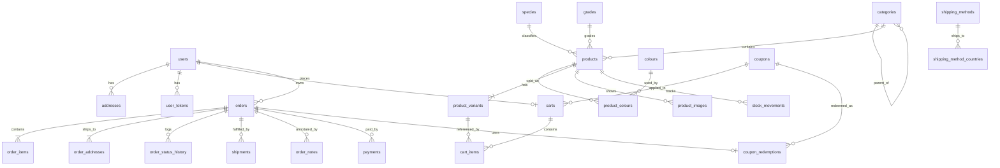

# PW Aquatics — Database Design

> Status: **Proposal — awaiting owner approval.** Once implementation starts,
> the Flyway migrations in `backend/src/main/resources/db/migration` are the
> source of truth; this document must be kept in sync with them.

Database: **PostgreSQL 18**. Extensions: `citext` (case-insensitive email and
coupon codes), `pg_trgm` (fuzzy product search).

---

## 1. Conventions

| Topic | Rule |
|---|---|
| Naming | `snake_case`, plural table names (`products`, `orders`) |
| Primary keys | `id uuid` — UUIDv7 generated by the application |
| Foreign keys | `<entity>_id`, always indexed, explicit `ON DELETE` behaviour |
| Money | `bigint` in minor units (cents), column suffix `_cents`; currency `char(3)` where needed |
| Percentages / tax | Basis points `int` (`1900` = 19.00 %), suffix `_bps` |
| Timestamps | `timestamptz`, stored in UTC; every table has `created_at`, mutable tables also `updated_at` |
| Optimistic locking | `version bigint not null default 0` on aggregates edited concurrently |
| Enums | `varchar` + `CHECK` constraint (easier to migrate than PostgreSQL `ENUM` types); mapped with `@Enumerated(STRING)` |
| Booleans | `not null` with a default |
| Soft delete | Not used generally. Products are **archived** (status), users are **anonymised**. Orders are never deleted. |
| Snapshots | Orders copy product names, prices and addresses at purchase time; later catalog edits never change past orders |

---

## 2. Entity-relationship overview



---

## 3. Schema

The DDL below is the **reference design**, grouped by topic rather than in
executable order (some foreign keys point to tables defined further down).
Migrations will implement it in small steps per roadmap phase (see §5).

### 3.1 Identity and customers

```sql
CREATE EXTENSION IF NOT EXISTS citext;
CREATE EXTENSION IF NOT EXISTS pg_trgm;

CREATE TABLE users (
    id                    uuid PRIMARY KEY,
    email                 citext       NOT NULL UNIQUE,   -- stored lower-case by the application
    password_hash         varchar(255),                   -- NULL only for anonymised accounts
    first_name            varchar(100) NOT NULL,
    last_name             varchar(100) NOT NULL,
    phone                 varchar(40),
    locale                varchar(5)   NOT NULL DEFAULT 'en',   -- language of emails: 'en' | 'de'
    role                  varchar(20)  NOT NULL DEFAULT 'CUSTOMER'
                          CHECK (role IN ('CUSTOMER', 'ADMIN')),
    status                varchar(20)  NOT NULL DEFAULT 'ACTIVE'
                          CHECK (status IN ('ACTIVE', 'LOCKED', 'ANONYMISED')),
    email_verified_at     timestamptz,
    failed_login_attempts int          NOT NULL DEFAULT 0,
    locked_until          timestamptz,
    last_login_at         timestamptz,
    marketing_opt_in      boolean      NOT NULL DEFAULT false,
    created_at            timestamptz  NOT NULL DEFAULT now(),
    updated_at            timestamptz  NOT NULL DEFAULT now(),
    version               bigint       NOT NULL DEFAULT 0,
    CHECK (password_hash IS NOT NULL OR status = 'ANONYMISED')
);

-- One-time tokens for email verification, password reset and email change.
-- Only a SHA-256 hash of the token is stored; the raw token is only in the email.
CREATE TABLE user_tokens (
    id          uuid PRIMARY KEY,
    user_id     uuid        NOT NULL REFERENCES users(id) ON DELETE CASCADE,
    type        varchar(30) NOT NULL CHECK (type IN ('EMAIL_VERIFICATION', 'PASSWORD_RESET', 'EMAIL_CHANGE')),
    token_hash  char(64)    NOT NULL UNIQUE,
    new_email   citext,                    -- target address, only for EMAIL_CHANGE
    expires_at  timestamptz NOT NULL,
    used_at     timestamptz,
    created_at  timestamptz NOT NULL DEFAULT now(),
    CHECK ((type = 'EMAIL_CHANGE') = (new_email IS NOT NULL))
);
CREATE INDEX idx_user_tokens_user ON user_tokens (user_id);

CREATE TABLE addresses (
    id                  uuid PRIMARY KEY,
    user_id             uuid         NOT NULL REFERENCES users(id) ON DELETE CASCADE,
    label               varchar(50),                -- "Home", "Office"
    first_name          varchar(100) NOT NULL,
    last_name           varchar(100) NOT NULL,
    company             varchar(150),
    street              varchar(150) NOT NULL,
    house_number        varchar(20)  NOT NULL,
    address_line2       varchar(150),
    postal_code         varchar(20)  NOT NULL,
    city                varchar(100) NOT NULL,
    country_code        char(2)      NOT NULL,      -- ISO 3166-1 alpha-2
    phone               varchar(40),                -- carriers often need it for live-animal express
    is_default_shipping boolean      NOT NULL DEFAULT false,
    is_default_billing  boolean      NOT NULL DEFAULT false,
    created_at          timestamptz  NOT NULL DEFAULT now(),
    updated_at          timestamptz  NOT NULL DEFAULT now()
);
CREATE INDEX idx_addresses_user ON addresses (user_id);
CREATE UNIQUE INDEX uq_addresses_default_shipping ON addresses (user_id) WHERE is_default_shipping;
CREATE UNIQUE INDEX uq_addresses_default_billing  ON addresses (user_id) WHERE is_default_billing;
```

**Sessions:** `spring_session` and `spring_session_attributes` are created by a
Flyway migration that copies Spring Session's official PostgreSQL schema.

**Notes**

- `users.status = 'LOCKED'` is a lock set by an administrator. The temporary lock
  after repeated wrong passwords is `locked_until` (with `failed_login_attempts`).
- Emails are compared case-insensitively: the application lower-cases them before
  storing or querying (a `varchar` parameter compared with a `citext` column would
  otherwise be case-sensitive), and `citext` guards uniqueness in any case.
- `addresses.user_id` is a plain id for the `customer` module (no entity link to
  `users`); `country_code` is upper-case ISO 3166-1 alpha-2 (`CHECK`).
- `audit_log` also has an index on `actor_user_id`. Actions written so far:
  `USER_REGISTERED`, `USER_LOCKED_AFTER_FAILED_LOGINS`, `USER_PASSWORD_CHANGED`,
  `USER_PASSWORD_RESET`, `USER_EMAIL_CHANGED`, `USER_ACCOUNT_DELETED`.
- Expired `user_tokens` are purged daily, one week after expiry.

### 3.2 Catalog

```sql
CREATE TABLE categories (
    id          uuid PRIMARY KEY,
    parent_id   uuid         REFERENCES categories(id) ON DELETE RESTRICT,
    name        varchar(100) NOT NULL,
    slug        varchar(120) NOT NULL UNIQUE,
    description text,
    image_key   varchar(255),
    sort_order  int          NOT NULL DEFAULT 0,
    active      boolean      NOT NULL DEFAULT true,
    created_at  timestamptz  NOT NULL DEFAULT now(),
    updated_at  timestamptz  NOT NULL DEFAULT now()
);
CREATE INDEX idx_categories_parent ON categories (parent_id);
-- e.g. Shrimp > Neocaridina | Caridina; Snails; Crayfish; Crabs; Mussels

CREATE TABLE species (
    id                uuid PRIMARY KEY,
    scientific_name   varchar(150) NOT NULL UNIQUE,   -- "Neocaridina davidi"
    common_name       varchar(150),                   -- "Zwerggarnele"
    slug              varchar(170) NOT NULL UNIQUE,
    description       text,
    origin            varchar(150),
    -- Care parameters shown on product and species pages
    temp_min_c        numeric(4,1),
    temp_max_c        numeric(4,1),
    ph_min            numeric(3,1),
    ph_max            numeric(3,1),
    gh_min            smallint,
    gh_max            smallint,
    kh_min            smallint,
    kh_max            smallint,
    tds_min           smallint,
    tds_max           smallint,
    adult_size_mm     smallint,
    lifespan_months   smallint,
    difficulty        varchar(20) CHECK (difficulty IN ('BEGINNER', 'INTERMEDIATE', 'ADVANCED')),
    -- Legal guard: e.g. species on the EU invasive alien species list
    trade_restricted  boolean      NOT NULL DEFAULT false,
    restriction_note  text,
    created_at        timestamptz  NOT NULL DEFAULT now(),
    updated_at        timestamptz  NOT NULL DEFAULT now(),
    CHECK (temp_min_c IS NULL OR temp_max_c IS NULL OR temp_min_c <= temp_max_c),
    CHECK (ph_min IS NULL OR ph_max IS NULL OR ph_min <= ph_max)
);

CREATE TABLE colours (
    id          uuid PRIMARY KEY,
    name        varchar(60) NOT NULL,
    slug        varchar(80) NOT NULL UNIQUE,
    hex_code    char(7),                               -- swatch colour, e.g. '#1E4FA3'
    sort_order  int         NOT NULL DEFAULT 0
);

CREATE TABLE grades (
    id          uuid PRIMARY KEY,
    name        varchar(60) NOT NULL,                  -- "SSS", "High Grade"
    slug        varchar(80) NOT NULL UNIQUE,
    scale       varchar(50),                           -- optional grouping, e.g. 'CARIDINA_CRS', 'NEOCARIDINA'
    description text,
    rank        smallint    NOT NULL DEFAULT 0,        -- higher = better, used for sorting
    sort_order  int         NOT NULL DEFAULT 0
);

CREATE TABLE products (
    id                   uuid PRIMARY KEY,
    slug                 varchar(180) NOT NULL UNIQUE,
    name                 varchar(150) NOT NULL,        -- "Blue Dream"
    species_id           uuid         REFERENCES species(id)    ON DELETE RESTRICT,  -- nullable for future non-animal items
    category_id          uuid         NOT NULL REFERENCES categories(id) ON DELETE RESTRICT,
    grade_id             uuid         REFERENCES grades(id)     ON DELETE RESTRICT,
    short_description    varchar(300),
    description          text,                          -- Markdown, sanitised on render
    care_notes           text,
    status               varchar(20)  NOT NULL DEFAULT 'DRAFT'
                         CHECK (status IN ('DRAFT', 'ACTIVE', 'ARCHIVED')),
    is_live_animal       boolean      NOT NULL DEFAULT true,
    featured             boolean      NOT NULL DEFAULT false,
    -- Inventory: number of individual animals (units) on hand.
    stock_units          int          NOT NULL DEFAULT 0 CHECK (stock_units >= 0),
    low_stock_threshold  int          NOT NULL DEFAULT 5 CHECK (low_stock_threshold >= 0),
    available_from       date,                          -- "coming soon" when no stock
    tax_rate_bps         int          NOT NULL DEFAULT 1900 CHECK (tax_rate_bps BETWEEN 0 AND 10000),
    -- Denormalised from active variants for fast filtering/sorting (maintained by the service layer)
    min_price_cents      bigint,
    seo_title            varchar(160),
    seo_description      varchar(320),
    published_at         timestamptz,
    created_at           timestamptz  NOT NULL DEFAULT now(),
    updated_at           timestamptz  NOT NULL DEFAULT now(),
    version              bigint       NOT NULL DEFAULT 0
);
CREATE INDEX idx_products_status_category ON products (status, category_id);
CREATE INDEX idx_products_species         ON products (species_id);
CREATE INDEX idx_products_grade           ON products (grade_id);
CREATE INDEX idx_products_min_price       ON products (min_price_cents);
CREATE INDEX idx_products_featured        ON products (featured) WHERE featured;
CREATE INDEX idx_products_name_trgm       ON products USING gin (name gin_trgm_ops);

CREATE TABLE product_colours (
    product_id  uuid NOT NULL REFERENCES products(id) ON DELETE CASCADE,
    colour_id   uuid NOT NULL REFERENCES colours(id)  ON DELETE RESTRICT,
    PRIMARY KEY (product_id, colour_id)
);
CREATE INDEX idx_product_colours_colour ON product_colours (colour_id);

-- A variant is a pack size with its own price, e.g. "1 animal" or "10 animals".
CREATE TABLE product_variants (
    id                     uuid PRIMARY KEY,
    product_id             uuid         NOT NULL REFERENCES products(id) ON DELETE CASCADE,
    sku                    varchar(64)  NOT NULL UNIQUE,
    name                   varchar(100) NOT NULL,
    pack_size              int          NOT NULL DEFAULT 1 CHECK (pack_size > 0),
    price_cents            bigint       NOT NULL CHECK (price_cents >= 0),
    compare_at_price_cents bigint       CHECK (compare_at_price_cents IS NULL OR compare_at_price_cents > price_cents),
    active                 boolean      NOT NULL DEFAULT true,
    sort_order             int          NOT NULL DEFAULT 0,
    created_at             timestamptz  NOT NULL DEFAULT now(),
    updated_at             timestamptz  NOT NULL DEFAULT now(),
    version                bigint       NOT NULL DEFAULT 0
);
CREATE INDEX idx_product_variants_product ON product_variants (product_id);

CREATE TABLE product_images (
    id          uuid PRIMARY KEY,
    product_id  uuid         NOT NULL REFERENCES products(id) ON DELETE CASCADE,
    storage_key varchar(255) NOT NULL,     -- base key; sized WebP renditions derived from it
    alt_text    varchar(255) NOT NULL,
    width       int          NOT NULL,
    height      int          NOT NULL,
    sort_order  int          NOT NULL DEFAULT 0,  -- 0 = primary image
    created_at  timestamptz  NOT NULL DEFAULT now()
);
CREATE INDEX idx_product_images_product ON product_images (product_id, sort_order);
```

**Availability (derived, not stored):**

| Value | Rule |
|---|---|
| `IN_STOCK` | status `ACTIVE` and at least one active variant with `pack_size <= stock_units` |
| `LOW_STOCK` | `IN_STOCK` and `stock_units <= low_stock_threshold` |
| `COMING_SOON` | not in stock and `available_from` is set |
| `OUT_OF_STOCK` | otherwise |

Only `ACTIVE` products whose species is not `trade_restricted` are visible in
the public catalog. The service layer refuses to activate a product of a
restricted species.

### 3.3 Inventory

```sql
-- Append-only ledger. products.stock_units is the current balance;
-- the sum of deltas per product must always equal it.
CREATE TABLE stock_movements (
    id           uuid PRIMARY KEY,
    product_id   uuid        NOT NULL REFERENCES products(id) ON DELETE CASCADE,
    delta        int         NOT NULL CHECK (delta <> 0),
    stock_after  int         NOT NULL CHECK (stock_after >= 0),
    reason       varchar(30) NOT NULL CHECK (reason IN (
                     'INITIAL', 'RESTOCK', 'ORDER_PLACED', 'ORDER_CANCELLED',
                     'MANUAL_ADJUSTMENT', 'LOSS', 'RETURN')),
    order_id     uuid        REFERENCES orders(id) ON DELETE SET NULL,
    note         varchar(500),
    created_by   uuid        REFERENCES users(id) ON DELETE SET NULL,
    created_at   timestamptz NOT NULL DEFAULT now()
);
CREATE INDEX idx_stock_movements_product ON stock_movements (product_id, created_at DESC);
CREATE INDEX idx_stock_movements_order   ON stock_movements (order_id);
```

Placing an order writes one `ORDER_PLACED` movement per product (negative delta, all
pack sizes of the product together); cancelling an unshipped order writes the matching
`ORDER_CANCELLED` movement. Both happen in the same transaction as the order change.

### 3.4 Shipping and settings

```sql
CREATE TABLE shipping_methods (
    id                            uuid PRIMARY KEY,
    code                          varchar(50)  NOT NULL UNIQUE,   -- 'DHL_LIVE_DE'
    name                          varchar(100) NOT NULL,
    description                   varchar(500),
    carrier                       varchar(50),
    price_cents                   bigint       NOT NULL CHECK (price_cents >= 0),
    -- Orders with a goods value of at least this amount ship for free.
    free_shipping_threshold_cents bigint       CHECK (free_shipping_threshold_cents > 0),
    live_animals_allowed          boolean      NOT NULL DEFAULT true,
    -- ISO weekdays on which parcels are handed to the carrier (1 = Monday ... 7 = Sunday)
    dispatch_weekdays             smallint[]   NOT NULL DEFAULT '{1,2,3}'
        CHECK (cardinality(dispatch_weekdays) > 0
               AND dispatch_weekdays <@ ARRAY[1, 2, 3, 4, 5, 6, 7]::smallint[]),
    estimated_days_min            smallint     CHECK (estimated_days_min >= 0),
    estimated_days_max            smallint,                       -- >= estimated_days_min
    active                        boolean      NOT NULL DEFAULT true,
    sort_order                    int          NOT NULL DEFAULT 0,
    created_at                    timestamptz  NOT NULL DEFAULT now(),
    updated_at                    timestamptz  NOT NULL DEFAULT now()
);

CREATE TABLE shipping_method_countries (
    shipping_method_id uuid    NOT NULL REFERENCES shipping_methods(id) ON DELETE CASCADE,
    country_code       char(2) NOT NULL CHECK (country_code ~ '^[A-Z]{2}$'),
    PRIMARY KEY (shipping_method_id, country_code)
);
CREATE INDEX idx_shipping_method_countries_country ON shipping_method_countries (country_code);

-- Small key/value store for shop-wide switches, e.g.
-- 'shipping.pause' = {"active": true, "message": "Heat wave", "until": "2027-08-12"}
CREATE TABLE shop_settings (
    key         varchar(100) PRIMARY KEY,
    value       jsonb        NOT NULL,
    updated_at  timestamptz  NOT NULL DEFAULT now(),
    updated_by  uuid         REFERENCES users(id) ON DELETE SET NULL
);
CREATE INDEX idx_shop_settings_updated_by ON shop_settings (updated_by);
```

Notes: the shop delivers to the EU and the United Kingdom with DHL and dispatches
Monday to Wednesday; the real methods and prices are data in `shipping_methods`
(the dev seed contains placeholders). `shipping.pause` applies to parcels with live
animals: with `until` the dispatch date moves behind that day, without it such orders
cannot be placed. A missing or unreadable setting counts as "no pause". Payment
deadline and handling time are configuration (`ORDER_BANK_TRANSFER_PAYMENT_DAYS`,
`SHIPPING_HANDLING_DAYS`), not settings.

### 3.5 Coupons

```sql
CREATE TABLE coupons (
    id                       uuid PRIMARY KEY,
    code                     citext       NOT NULL UNIQUE,
    description              varchar(255),
    type                     varchar(20)  NOT NULL CHECK (type IN ('PERCENTAGE', 'FIXED_AMOUNT', 'FREE_SHIPPING')),
    -- PERCENTAGE: basis points (1000 = 10 %); FIXED_AMOUNT: cents; FREE_SHIPPING: 0
    value                    bigint       NOT NULL CHECK (value >= 0),
    min_order_cents          bigint       NOT NULL DEFAULT 0,
    max_discount_cents       bigint,                    -- cap for percentage coupons
    starts_at                timestamptz,
    ends_at                  timestamptz,
    usage_limit_total        int,
    usage_limit_per_customer int,
    times_redeemed           int          NOT NULL DEFAULT 0,
    active                   boolean      NOT NULL DEFAULT true,
    created_at               timestamptz  NOT NULL DEFAULT now(),
    updated_at               timestamptz  NOT NULL DEFAULT now(),
    version                  bigint       NOT NULL DEFAULT 0,
    CHECK (type <> 'PERCENTAGE' OR value <= 10000),
    CHECK (starts_at IS NULL OR ends_at IS NULL OR starts_at < ends_at)
);

CREATE TABLE coupon_redemptions (
    id             uuid PRIMARY KEY,
    coupon_id      uuid        NOT NULL REFERENCES coupons(id) ON DELETE RESTRICT,
    order_id       uuid        NOT NULL UNIQUE REFERENCES orders(id) ON DELETE CASCADE,
    user_id        uuid        REFERENCES users(id) ON DELETE SET NULL,
    email          citext      NOT NULL,
    discount_cents bigint      NOT NULL,
    redeemed_at    timestamptz NOT NULL DEFAULT now()
);
CREATE INDEX idx_coupon_redemptions_coupon_user ON coupon_redemptions (coupon_id, user_id);
```

`times_redeemed` is incremented with a conditional update inside the order
transaction (`WHERE usage_limit_total IS NULL OR times_redeemed < usage_limit_total`)
so a limited coupon cannot be over-redeemed. A cancelled order releases its
redemption.

### 3.6 Cart

```sql
CREATE TABLE carts (
    id                    uuid PRIMARY KEY,
    user_id               uuid        UNIQUE REFERENCES users(id) ON DELETE CASCADE,
    anonymous_token_hash  char(64)    UNIQUE,         -- SHA-256 of the guest cart cookie
    coupon_id             uuid        REFERENCES coupons(id) ON DELETE SET NULL,   -- added in Phase 8
    created_at            timestamptz NOT NULL DEFAULT now(),
    updated_at            timestamptz NOT NULL DEFAULT now(),
    expires_at            timestamptz,                 -- guest carts only: 30 days after the last change
    CHECK ((user_id IS NULL) <> (anonymous_token_hash IS NULL))   -- exactly one kind of owner
);
CREATE INDEX idx_carts_expires ON carts (expires_at) WHERE expires_at IS NOT NULL;

CREATE TABLE cart_items (
    id          uuid PRIMARY KEY,
    cart_id     uuid        NOT NULL REFERENCES carts(id) ON DELETE CASCADE,
    variant_id  uuid        NOT NULL REFERENCES product_variants(id) ON DELETE CASCADE,
    quantity    int         NOT NULL CHECK (quantity BETWEEN 1 AND 999),
    created_at  timestamptz NOT NULL DEFAULT now(),
    updated_at  timestamptz NOT NULL DEFAULT now(),
    UNIQUE (cart_id, variant_id)
);
CREATE INDEX idx_cart_items_variant ON cart_items (variant_id);
```

Notes: the cart deliberately stores **no prices**. `carts.user_id` and
`cart_items.variant_id` are plain ids for the `cart` module (no entity links to
other modules). Expired guest carts are deleted daily; a customer's cart is
removed when the account is deleted. Carts are always loaded `FOR UPDATE`, so
simultaneous requests for one cart run one after the other.


### 3.7 Orders, fulfilment and payments

```sql
CREATE SEQUENCE order_number_seq;   -- order_number = 'PW-' || year || '-' || lpad(nextval, 6, '0')

CREATE TABLE orders (
    id                    uuid PRIMARY KEY,
    order_number          varchar(20)  NOT NULL UNIQUE,     -- 'PW-2027-000123'
    user_id               uuid         REFERENCES users(id) ON DELETE SET NULL,
    customer_email        citext       NOT NULL,
    customer_locale       varchar(5)   NOT NULL DEFAULT 'en',            -- language of order emails
    status                varchar(20)  NOT NULL CHECK (status IN (
                              'PENDING_PAYMENT', 'PAID', 'PROCESSING', 'SHIPPED', 'DELIVERED', 'CANCELLED')),
    payment_status        varchar(20)  NOT NULL DEFAULT 'UNPAID' CHECK (payment_status IN (
                              'UNPAID', 'PAID', 'PARTIALLY_REFUNDED', 'REFUNDED', 'FAILED')),
    payment_method        varchar(30)  NOT NULL CHECK (payment_method IN (
                              'BANK_TRANSFER', 'STRIPE', 'PAYPAL')),
    currency              char(3)      NOT NULL DEFAULT 'EUR',
    -- All amounts gross (incl. VAT), in cents, calculated server-side
    subtotal_cents        bigint       NOT NULL CHECK (subtotal_cents >= 0),
    discount_cents        bigint       NOT NULL DEFAULT 0 CHECK (discount_cents >= 0),
    shipping_cents        bigint       NOT NULL CHECK (shipping_cents >= 0),
    total_cents           bigint       NOT NULL CHECK (total_cents >= 0),
    tax_cents             bigint       NOT NULL CHECK (tax_cents >= 0),   -- VAT contained in total
    coupon_code           varchar(64),                                    -- snapshot
    shipping_method_code  varchar(50)  NOT NULL,                          -- snapshot
    shipping_method_name  varchar(100) NOT NULL,                          -- snapshot
    shipping_carrier      varchar(50),                                    -- snapshot
    planned_dispatch_date date,                                           -- earliest dispatch day
    customer_note         varchar(1000),
    terms_accepted_at     timestamptz  NOT NULL,                          -- proof of the customer's consent
    idempotency_key       varchar(100),
    placed_at             timestamptz  NOT NULL,
    payment_due_at        timestamptz,                                    -- expiry for unpaid orders
    paid_at               timestamptz,
    cancelled_at          timestamptz,
    cancellation_reason   varchar(500),
    created_at            timestamptz  NOT NULL DEFAULT now(),
    updated_at            timestamptz  NOT NULL DEFAULT now(),
    version               bigint       NOT NULL DEFAULT 0,
    CHECK (total_cents = subtotal_cents - discount_cents + shipping_cents),
    UNIQUE (user_id, idempotency_key)
);
CREATE INDEX idx_orders_user_placed   ON orders (user_id, placed_at DESC);
CREATE INDEX idx_orders_status_placed ON orders (status, placed_at DESC);
CREATE INDEX idx_orders_placed        ON orders (placed_at);
CREATE INDEX idx_orders_payment_due   ON orders (payment_due_at) WHERE status = 'PENDING_PAYMENT';

CREATE TABLE order_items (
    id                uuid PRIMARY KEY,
    order_id          uuid         NOT NULL REFERENCES orders(id) ON DELETE CASCADE,
    product_id        uuid         REFERENCES products(id)         ON DELETE SET NULL,
    variant_id        uuid         REFERENCES product_variants(id) ON DELETE SET NULL,
    position          int          NOT NULL,             -- order of the lines
    -- Snapshot at time of purchase
    sku               varchar(64)  NOT NULL,
    product_name      varchar(150) NOT NULL,
    variant_name      varchar(100) NOT NULL,
    species_name      varchar(150),
    grade_name        varchar(60),
    is_live_animal    boolean      NOT NULL,
    pack_size         int          NOT NULL,
    unit_price_cents  bigint       NOT NULL,
    quantity          int          NOT NULL CHECK (quantity > 0),
    discount_cents    bigint       NOT NULL DEFAULT 0,   -- allocated share of order discount
    line_total_cents  bigint       NOT NULL,             -- unit_price × qty − discount
    tax_rate_bps      int          NOT NULL,
    tax_cents         bigint       NOT NULL
);
CREATE INDEX idx_order_items_order   ON order_items (order_id, position);
CREATE INDEX idx_order_items_product ON order_items (product_id);
CREATE INDEX idx_order_items_variant ON order_items (variant_id);

-- Address snapshots (never references the editable addresses table)
CREATE TABLE order_addresses (
    order_id      uuid         NOT NULL REFERENCES orders(id) ON DELETE CASCADE,
    type          varchar(10)  NOT NULL CHECK (type IN ('SHIPPING', 'BILLING')),
    first_name    varchar(100) NOT NULL,
    last_name     varchar(100) NOT NULL,
    company       varchar(150),
    street        varchar(150) NOT NULL,
    house_number  varchar(20)  NOT NULL,
    address_line2 varchar(150),
    postal_code   varchar(20)  NOT NULL,
    city          varchar(100) NOT NULL,
    country_code  char(2)      NOT NULL,
    phone         varchar(40),
    PRIMARY KEY (order_id, type)
);

CREATE TABLE order_status_history (
    id                uuid PRIMARY KEY,
    order_id          uuid        NOT NULL REFERENCES orders(id) ON DELETE CASCADE,
    from_status       varchar(20),
    to_status         varchar(20) NOT NULL,
    note              varchar(1000),          -- internal note
    customer_message  varchar(1000),          -- shown to the customer, if any
    changed_by        uuid        REFERENCES users(id) ON DELETE SET NULL,   -- null = system
    created_at        timestamptz NOT NULL DEFAULT now()
);
CREATE INDEX idx_order_status_history_order      ON order_status_history (order_id, created_at);
CREATE INDEX idx_order_status_history_changed_by ON order_status_history (changed_by);

-- Phase 7: internal admin notes on an order (never shown to the customer)
CREATE TABLE order_notes (
    id          uuid PRIMARY KEY,
    order_id    uuid          NOT NULL REFERENCES orders(id) ON DELETE CASCADE,
    author_id   uuid          REFERENCES users(id) ON DELETE SET NULL,
    body        varchar(2000) NOT NULL,
    created_at  timestamptz   NOT NULL DEFAULT now()
);
CREATE INDEX idx_order_notes_order ON order_notes (order_id, created_at);

-- Phase 7
CREATE TABLE shipments (
    id               uuid PRIMARY KEY,
    order_id         uuid         NOT NULL REFERENCES orders(id) ON DELETE CASCADE,
    carrier          varchar(50)  NOT NULL,
    tracking_number  varchar(100) NOT NULL,
    tracking_url     varchar(500),          -- built from a per-carrier URL template
    shipped_at       timestamptz  NOT NULL,
    delivered_at     timestamptz,
    created_by       uuid         REFERENCES users(id) ON DELETE SET NULL,
    created_at       timestamptz  NOT NULL DEFAULT now(),
    updated_at       timestamptz  NOT NULL DEFAULT now()
);
CREATE INDEX idx_shipments_order ON shipments (order_id);
CREATE INDEX idx_shipments_tracking ON shipments (tracking_number);

-- Phase 9 (payments). Never contains card data — only provider references.
CREATE TABLE payments (
    id                   uuid PRIMARY KEY,
    order_id             uuid         NOT NULL REFERENCES orders(id) ON DELETE RESTRICT,
    provider             varchar(20)  NOT NULL CHECK (provider IN ('BANK_TRANSFER', 'STRIPE', 'PAYPAL')),
    provider_reference   varchar(255) UNIQUE,     -- PaymentIntent ID / PayPal order ID
    status               varchar(20)  NOT NULL CHECK (status IN (
                             'CREATED', 'PENDING', 'SUCCEEDED', 'FAILED', 'CANCELLED', 'REFUNDED', 'PARTIALLY_REFUNDED')),
    amount_cents         bigint       NOT NULL,
    refunded_cents       bigint       NOT NULL DEFAULT 0,
    currency             char(3)      NOT NULL DEFAULT 'EUR',
    method_detail        varchar(50),             -- e.g. 'card', 'apple_pay' (no card numbers)
    created_at           timestamptz  NOT NULL DEFAULT now(),
    updated_at           timestamptz  NOT NULL DEFAULT now()
);
CREATE INDEX idx_payments_order ON payments (order_id);

CREATE TABLE payment_webhook_events (
    id            uuid PRIMARY KEY,
    provider      varchar(20)  NOT NULL,
    event_id      varchar(255) NOT NULL,
    event_type    varchar(100) NOT NULL,
    payload       jsonb        NOT NULL,
    received_at   timestamptz  NOT NULL DEFAULT now(),
    processed_at  timestamptz,
    error         text,
    UNIQUE (provider, event_id)                   -- idempotency
);

-- Later: sequential, gap-free invoice numbers as required for German invoices
CREATE TABLE invoices (
    id              uuid PRIMARY KEY,
    order_id        uuid         NOT NULL UNIQUE REFERENCES orders(id) ON DELETE RESTRICT,
    invoice_number  varchar(30)  NOT NULL UNIQUE,
    issued_at       timestamptz  NOT NULL,
    storage_key     varchar(255) NOT NULL         -- generated PDF
);
```

Notes on orders (built in Phase 5: `orders`, `order_items`, `order_addresses`,
`order_status_history`): every amount is calculated by the server with
`PriceCalculator`; items, prices, names and addresses are snapshots and are never
updated. `order_items` additionally checks `line_total_cents = unit_price_cents ×
quantity − discount_cents`. An order number is `PW-<year>-<6 digits>` from
`order_number_seq` (gaps are fine). `UNIQUE (user_id, idempotency_key)` backs the
idempotent placement. Orders are locked `FOR UPDATE` when they are cancelled or expire.

### 3.8 Content

```sql
CREATE TABLE gallery_images (
    id           uuid PRIMARY KEY,
    storage_key  varchar(255) NOT NULL,
    title        varchar(150),
    caption      varchar(500),
    alt_text     varchar(255) NOT NULL,
    species_id   uuid         REFERENCES species(id) ON DELETE SET NULL,
    width        int          NOT NULL,
    height       int          NOT NULL,
    sort_order   int          NOT NULL DEFAULT 0,
    published    boolean      NOT NULL DEFAULT false,
    created_at   timestamptz  NOT NULL DEFAULT now()
);
CREATE INDEX idx_gallery_published ON gallery_images (published, sort_order);

CREATE TABLE contact_messages (
    id            uuid PRIMARY KEY,
    name          varchar(150)  NOT NULL,
    email         citext        NOT NULL,
    subject       varchar(200)  NOT NULL,
    message       varchar(5000) NOT NULL,
    order_number  varchar(20),
    status        varchar(20)   NOT NULL DEFAULT 'NEW' CHECK (status IN ('NEW', 'READ', 'ANSWERED', 'SPAM')),
    created_at    timestamptz   NOT NULL DEFAULT now()
);
CREATE INDEX idx_contact_messages_status ON contact_messages (status, created_at DESC);
```

### 3.9 Operations

```sql
-- Transactional outbox: written in the same transaction as the business change,
-- delivered by a scheduled worker with retries.
CREATE TABLE outbox_messages (
    id               uuid PRIMARY KEY,
    type             varchar(50)  NOT NULL,          -- 'EMAIL' (payload: to, replyTo, subject, body)
    payload          jsonb        NOT NULL,
    status           varchar(20)  NOT NULL DEFAULT 'PENDING' CHECK (status IN ('PENDING', 'SENT', 'FAILED')),
    attempts         int          NOT NULL DEFAULT 0,
    next_attempt_at  timestamptz  NOT NULL DEFAULT now(),
    last_error       text,
    created_at       timestamptz  NOT NULL DEFAULT now(),
    sent_at          timestamptz
);
CREATE INDEX idx_outbox_pending ON outbox_messages (next_attempt_at) WHERE status = 'PENDING';

CREATE TABLE audit_log (
    id            bigint GENERATED ALWAYS AS IDENTITY PRIMARY KEY,
    actor_user_id uuid         REFERENCES users(id) ON DELETE SET NULL,
    action        varchar(100) NOT NULL,             -- 'PRODUCT_UPDATED', 'ORDER_STATUS_CHANGED', 'LOGIN_FAILED'
    entity_type   varchar(50),
    entity_id     uuid,
    details       jsonb,                             -- changed fields; never passwords or tokens
    ip_address    inet,
    created_at    timestamptz  NOT NULL DEFAULT now()
);
CREATE INDEX idx_audit_log_entity  ON audit_log (entity_type, entity_id);
CREATE INDEX idx_audit_log_created ON audit_log (created_at DESC);

-- ShedLock table for scheduled jobs
CREATE TABLE shedlock (
    name       varchar(64)  PRIMARY KEY,
    lock_until timestamptz  NOT NULL,
    locked_at  timestamptz  NOT NULL,
    locked_by  varchar(255) NOT NULL
);
```

---

## 4. Key queries and integrity rules

**Catalog filter** (built with JPA Specifications / Criteria, all parameters optional):

```sql
SELECT p.* FROM products p
JOIN species s ON s.id = p.species_id
WHERE p.status = 'ACTIVE' AND s.trade_restricted = false
  AND s.slug = ANY(:species)
  AND p.grade_id IN (SELECT id FROM grades WHERE slug = ANY(:grades))
  AND EXISTS (SELECT 1 FROM product_colours pc JOIN colours c ON c.id = pc.colour_id
              WHERE pc.product_id = p.id AND c.slug = ANY(:colours))
  AND p.min_price_cents BETWEEN :minPrice AND :maxPrice
  AND (:inStockOnly = false OR EXISTS (SELECT 1 FROM product_variants v
       WHERE v.product_id = p.id AND v.active AND v.pack_size <= p.stock_units))
ORDER BY p.featured DESC, p.published_at DESC
LIMIT :size OFFSET :offset;
```

Facet counts (how many products per colour/grade/species for the current
filter) are computed with grouped queries over the same base filter.

**Stock decrement** (inside the order transaction, after `SELECT … FOR UPDATE`):

```sql
UPDATE products
SET stock_units = stock_units - :units
WHERE id = :productId AND stock_units >= :units;
-- 0 rows updated ⇒ INSUFFICIENT_STOCK, transaction rolled back
```

`stock_units` is never written through the `Product` entity (the column is mapped
read-only); every change is one of these conditional updates (orders, manual
adjustments, stocktakes). That is why stock changes do not touch `version`: editing a
product's texts while an order comes in is no conflict, and a stale editor can never
overwrite the stock.

**Statistics** (dashboard, docs/API.md §3.1) are a read model in the `admin` module
(`StatisticsQueries`): plain aggregate SQL over `orders`, `order_items`, `order_addresses`,
`products`, `categories`, `grades`, `users` and `stock_movements`, never writing. Sales are
orders that are neither cancelled nor refunded, grouped by the day they were placed in the
shop's time zone:

```sql
SELECT date_trunc(:unit, o.placed_at AT TIME ZONE 'Europe/Berlin')::date AS bucket,
       o.payment_status IN ('PAID', 'PARTIALLY_REFUNDED')                  AS paid,
       count(*) AS orders, sum(o.total_cents) AS revenue_cents
FROM orders o
WHERE o.placed_at >= :start AND o.placed_at < :end          -- period start/end in Berlin
  AND o.status <> 'CANCELLED' AND o.payment_status <> 'REFUNDED'
GROUP BY 1, 2 ORDER BY 1;
```

The existing indexes (`orders(placed_at)`, `order_items(order_id)`,
`stock_movements(product_id, created_at)`) are enough at the expected volume; a daily summary
table only if the dashboard gets slow (ARCHITECTURE.md risk R16). The statistics store
nothing; the CSV export holds no personal data.

**Invariants enforced in the database** (in addition to the service layer):
non-negative stock, unique SKUs/slugs/emails/coupon codes, one default address
per type per user, valid enum values, order total consistency, idempotency
uniqueness, webhook event uniqueness.

---

## 5. Migrations

- **Tool:** Flyway, SQL migrations only, in `backend/src/main/resources/db/migration`.
- **Naming:** `V<yyyy>_<MM>_<dd>_<HHmm>__<description>.sql`, e.g.
  `V2026_11_20_1030__create_catalog_tables.sql`. Timestamp versions avoid
  conflicts when several branches add migrations in parallel.
- **Immutable:** a migration that has been merged to `main` is never edited.
  Fixes are new migrations.
- **Hibernate:** `spring.jpa.hibernate.ddl-auto=validate` in every environment.
- **Seed data:** reference data needed in production (default categories,
  shipping methods, settings) goes into normal migrations. Demo products and test
  users live in `db/seed-dev` and are only loaded with the `dev` profile.
  `R__dev_catalog.sql` is a repeatable migration with fixed IDs and
  `ON CONFLICT … DO UPDATE`, so editing it refreshes the demo catalog. Don't run
  a database that has the dev seed with another profile (Flyway would report the
  repeatable migration as missing).
- **Zero-downtime habits:** add nullable column → backfill → add constraint;
  never rename/drop in the same release that stops using a column.
- **Testing:** every migration runs against a real PostgreSQL in CI (Testcontainers).

**Planned migration order** (one or more files per roadmap phase):

| Phase | Migrations |
|---|---|
| 0 | extensions, `shedlock`, `outbox_messages` |
| 1 | `contact_messages` |
| 2 | `categories`, `species`, `colours`, `grades`, `products`, `product_colours`, `product_variants`, `product_images`, `stock_movements` (without the `order_id` foreign key) |
| 3 | `users`, `user_tokens`, `addresses`, Spring Session tables, `audit_log`, foreign key `stock_movements.created_by → users` |
| 4 | `carts`, `cart_items` |
| 5 | `shipping_methods`, `shipping_method_countries`, `shop_settings`, `order_number_seq`, `orders`, `order_items`, `order_addresses`, `order_status_history`, foreign key `stock_movements.order_id → orders` |
| 6 | (inventory admin uses existing tables) |
| 7 | `shipments`, `order_notes`, `gallery_images` |
| 8 | `coupons`, `coupon_redemptions`, `carts.coupon_id` |
| 9 | `payments`, `payment_webhook_events` |
| 10 | `invoices` |

A foreign key that points to a table created in a later phase is added by
that later phase's migration.

---

## 6. Data protection

What the shop stores about people, why, and when it goes. Use this as the input for the
privacy policy and the record of processing activities (GDPR Art. 30); the legal bases
and periods are the technical proposal and must be confirmed by the owner's legal
adviser.

| Data | Where | Purpose / legal basis (GDPR) | Kept until |
|---|---|---|---|
| Account: email, name, phone (optional), language, password hash (Argon2id), login state | `users` | Customer account, Art. 6(1)(b) | Account deletion → row anonymised at once |
| Newsletter consent | `users.marketing_opt_in` + audit entries `MARKETING_CONSENT_GIVEN/WITHDRAWN` (time, source) | Consent, Art. 6(1)(a); proof per Art. 7(1) | Until withdrawn; no newsletter is sent yet |
| Saved addresses | `addresses` | Faster checkout, Art. 6(1)(b) | Deleted by the customer or with the account |
| Cart | `carts`, `cart_items` (variant ids only); guest carts via a random cookie, only its hash stored | Art. 6(1)(b) | Guest: 30 days after the last change; customer: with the account |
| Orders: email, language, items, prices, address snapshots, customer note, time of accepting the terms | `orders`, `order_items`, `order_addresses`, `order_status_history` | Contract Art. 6(1)(b); retention duty Art. 6(1)(c) with § 147 AO / § 257 HGB | Statutory retention (8 years for accounting vouchers, 6 years for business letters — period to be confirmed by the tax adviser); kept after account deletion; anonymisation job not built yet |
| Stock ledger | `stock_movements` (order id, no personal data) | Inventory | Permanent |
| Sessions | `spring_session` (user id and role only) | Login, Art. 6(1)(b) | 14 days without activity; deleted by Spring Session |
| One-time tokens (verify email, reset password, change email) | `user_tokens` (SHA-256 hash only) | Art. 6(1)(b) | 7 days after expiry |
| Emails to be sent | `outbox_messages` | Delivery of transactional emails | Text erased as soon as the email is sent; row deleted after 30 days (`app.retention.sent-emails`), undeliverable ones after 30 days |
| Contact form messages: name, email, message | `contact_messages` (+ the email to the shop inbox) | Answering the enquiry, Art. 6(1)(b)/(f) | 365 days (`app.retention.contact-messages`); copies in the shop mailbox follow the mailbox's own rules |
| Audit log: who did what, when; IP address | `audit_log` | Security, Art. 6(1)(f) | IP address erased after 90 days (`app.retention.audit-ip-addresses`); entries stay |
| Language choice | Browser `localStorage` key `pwa.language` (no personal data) | Requested by the user (§ 25(2) no. 2 TDDDG) | Until the visitor clears it |

**Cookies:** `SESSION` (login), `XSRF-TOKEN` (CSRF protection) and `CART_TOKEN` (guest
cart) are strictly necessary for services the visitor asks for, so no consent banner is
needed (§ 25(2) no. 2 TDDDG). Adding analytics, tracking, external fonts, maps or videos
would change that. Fonts are self-hosted; the site makes no third-party requests.

**Payment data:** none is stored. Customers pay by bank transfer to the shop's account
(configured in the environment, not in the database); the shop never asks for a
customer's bank or card details. With card and PayPal payments (Phase 9) the browser
talks to Stripe/PayPal directly and the shop keeps only provider references, status and
amounts (PCI DSS SAQ A); webhook payloads must be stored without billing details.

**Account deletion:** the user row is anonymised (`status = 'ANONYMISED'`, email
replaced with a placeholder, names and phone cleared, password hash and newsletter
consent removed), saved addresses, cart, one-time tokens and sessions are deleted.
Orders keep their snapshots for the statutory retention period, then a scheduled job
must anonymise them (not built yet; first due years after launch).

**Logs:** application logs contain ids and counts, never email addresses, names, IP
addresses, tokens or payment data. Unexpected errors are logged with their stack trace;
database errors can quote a value, so production logs must be kept short (see
`docs/ROADMAP.md`, Phase 10 "log retention").

**Data subject requests** (access, rectification, erasure, portability, objection):
customers see and edit their profile, addresses and orders in the account and can
delete the account themselves; everything else is answered by the owner within one
month, with the admin customer view (Phase 7) as the tool.

Backups are encrypted and follow the same retention.
