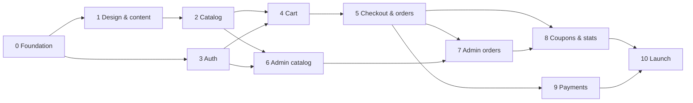

# Wakup Wirbellose — Development Roadmap

> Status: **Proposal — awaiting owner approval.** No phase starts without the
> owner's go-ahead. Each phase ends with a demo and review before the next begins.

Related: [ARCHITECTURE.md](ARCHITECTURE.md) · [DATABASE.md](DATABASE.md) · [API.md](API.md)

---

## Principles

- **Vertical slices.** Each phase delivers working backend + frontend + tests
  for its features, not "all backend first".
- **Always runnable.** `docker compose up` works at the end of every phase.
- **Definition of done** for every feature: server-side validation, migrations,
  tests (unit + integration + API), typed frontend integration, responsive UI,
  accessibility check, docs updated (see AGENTS.md).
- **Small pull requests** per feature within a phase.

---

## Phase overview

| Phase | Name | Main outcome |
|---|---|---|
| 0 | Foundation | Repo skeleton, Docker Compose, CI, empty but running apps |
| 1 | Brand, design system & content pages | The site looks like Wakup Wirbellose; Home, About, Gallery (static), Contact |
| 2 | Public catalog | Shop with filters, product and species pages, seed data |
| 3 | Authentication & accounts | Register, login/logout, verification, password reset, profile, addresses |
| 4 | Shopping cart | Persistent guest/customer cart with merge on login |
| 5 | Checkout & orders | Order placement with bank transfer, emails, order history & status |
| 6 | Admin I — catalog & inventory | Admin shell, products, images, taxonomy, stock management |
| 7 | Admin II — orders & fulfilment | Order management, status changes, tracking numbers, customers, gallery, contact inbox, shipping settings |
| 8 | Coupons & statistics | Coupons end-to-end, dashboard and sales statistics |
| 9 | Payments | Stripe (cards, Apple Pay, Google Pay), PayPal, webhooks, refunds |
| 10 | Launch readiness | SEO prerendering, legal, invoices, security & performance audits, production deployment |
| 11 | Post-launch | Improvements based on real usage |

A **soft launch** with bank transfer (Vorkasse) only is technically possible
after Phase 8 + the legal/security parts of Phase 10, if the owner wants to
start selling before card payments are ready.

---

## Phase 0 — Foundation

**Goal:** a clean, running skeleton with all tooling in place.

- Monorepo layout (`backend/`, `frontend/`, `infra/`, `docs/`).
- Backend: Spring Boot project (Gradle), packages per module, `common` kernel
  (Money, Problem Details handler, base entity, UUIDv7 IDs, Clock), Actuator,
  springdoc, Flyway with first migration (extensions, `shedlock`, `outbox_messages`),
  profiles `dev`/`test`/`prod`, Testcontainers base test, ArchUnit boundary test.
- Frontend: Vite + React + TypeScript (strict), Tailwind, React Router, TanStack
  Query, API client with CSRF handling, OpenAPI type generation script,
  ESLint + Prettier, Vitest.
- Docker: multi-stage Dockerfiles (non-root), `docker-compose.yml` with
  postgres, backend, mailpit; Vite proxy for `/api` and `/media`.
- `.env.example`, `.gitignore`, `.editorconfig`, README with setup instructions.
- GitHub Actions: build, test, lint, type-check, OpenAPI drift check, Docker build.
- Dependabot.

**Done when:** `docker compose up` starts DB + API; `npm run dev` shows a
placeholder page that calls `/api/v1/health`; CI is green.

## Phase 1 — Brand, design system & content pages

**Goal:** establish the premium look before building shop features.

- Design tokens in Tailwind `@theme`: colour palette, typography scale,
  spacing, radii, shadows, motion durations.
- Self-hosted fonts.
- UI primitives (`components/ui`): Button, Input, Select, Checkbox, Badge,
  Dialog, Drawer, Toast, Skeleton, ResponsiveImage, Price, EmptyState.
- Layout: header with navigation and cart icon, mobile menu, footer
  (legal links, contact), cookie consent banner.
- Pages: Home (hero, featured section placeholders, brand story teaser),
  About, Gallery (static images for now), Contact (form → `POST /contact`
  with rate limit + honeypot + `contact_messages` table + notification email),
  legal page shells, 404 page.
- i18n setup (German default).

**Owner input needed:** logo, brand colours approval, photography, about-us text.

**Done when:** pages are responsive, pass Lighthouse accessibility ≥ 95, and
the owner approves the visual direction.

## Phase 2 — Public catalog

**Goal:** customers can browse and filter the full assortment.

- Migrations: categories, species, colours, grades, products, product_colours,
  product_variants, product_images, stock_movements.
- Catalog module: read services, JPA Specifications for filters, facet counts,
  availability derivation, text search (`pg_trgm`), slug handling.
- Media module: storage abstraction (local disk first), image rendition URLs.
- Endpoints: `/products`, `/products/facets`, `/products/{slug}`,
  `/products/{slug}/related`, `/categories`, `/species`, `/species/{slug}`,
  `/colours`, `/grades`.
- Dev seed data: realistic species, products, variants and images.
- Frontend: Shop page (filter panel, chips, sorting, pagination, URL-synced
  filters, mobile filter drawer), ProductCard, Product page (gallery, variant
  selector, care table, availability), Species page, homepage featured products.
- Per-route meta tags and JSON-LD `Product`.

**Done when:** all five required filters (species, colour, grade, price,
availability) work in any combination, results are correct in integration tests,
and product pages render with real seed data.

## Phase 3 — Authentication & accounts

**Goal:** secure customer accounts.

- Migrations: users, user_tokens, addresses, Spring Session tables, audit_log.
- Spring Security: session auth, CSRF cookie-to-header, password encoder,
  login rate limiting and lockout, role model, method security.
- Endpoints: `/auth/*`, `/account/profile`, `/account/password`,
  `/account/email`, `/account/addresses`, `DELETE /account`.
- Transactional emails via outbox: verification, password reset, password changed.
- Admin bootstrap: first admin created from environment variables on startup
  if no admin exists.
- Frontend: login, register, verify email, forgot/reset password, account
  layout, profile, address book; `RequireAuth` / `RequireAdmin` guards.

**Done when:** security tests pass (CSRF required, session rotation, no account
enumeration, IDOR on addresses returns 404, lockout works).

## Phase 4 — Shopping cart

**Goal:** a persistent cart that never trusts the client.

- Migrations: carts, cart_items.
- Pricing module (first version): line totals, subtotal, included VAT.
- Guest cart cookie, customer cart, merge on login, cleanup job for expired guest carts.
- Endpoints: `/cart`, `/cart/items`.
- Frontend: add-to-cart from product page, cart drawer, cart page, warnings display.

**Done when:** cart survives logout/login and browser restarts, merge
edge cases are tested, manipulated requests cannot change prices.

## Phase 5 — Checkout & orders

**Goal:** customers can place real orders (bank transfer) and follow them.

- Migrations: shipping_methods, shipping_method_countries, shop_settings,
  orders, order_items, order_addresses, order_status_history, order number sequence.
- Shipping module: methods per country, dispatch weekday rules, next dispatch
  date calculation, shipping pause setting.
- Order module: quote, placement transaction with locking and idempotency,
  stock movements, state machine, expiry job for unpaid orders (returns stock).
- Bank-transfer payment provider (payment instructions).
- Emails: order confirmation (with bank details), order cancelled.
- Endpoints: `/checkout/*`, `/account/orders`, `/account/orders/{orderNumber}`,
  customer cancel.
- Frontend: multi-step checkout (address → shipping → review with mandatory
  checkboxes → "Zahlungspflichtig bestellen"), confirmation page, order history,
  order detail with status timeline.

**Done when:** the concurrency test (two buyers, last animal) passes, duplicate
submissions create one order, price change between quote and order is caught.

## Phase 6 — Admin I: catalog & inventory

**Goal:** the owner manages the assortment without developer help.

- Admin layout (lazy-loaded), navigation, data tables with search/sort/paging.
- Product editor: details, Markdown description with preview, species/category/
  grade/colours, SEO fields, variants table, publish/archive/duplicate.
- Image manager: upload with processing (resize, WebP, EXIF stripping),
  drag-to-reorder, alt texts.
- Taxonomy management: species (incl. care data and trade restriction),
  categories, colours, grades.
- Inventory: stock overview, low-stock filter, adjustments (restock, loss,
  correction), stocktake, movement history.
- Audit logging of all admin writes.

**Done when:** a new product can be created, photographed, published and
stocked entirely through the admin UI; non-admins get 403 on every admin endpoint.

## Phase 7 — Admin II: orders & fulfilment

**Goal:** the owner can process orders end-to-end.

- Migrations: shipments, order_notes, gallery_images.
- Order management: list with filters, detail, mark as paid, status changes
  (state machine), cancellation with restock, internal notes, packing slip PDF.
- Tracking: add/edit shipments with carrier + tracking number; carrier
  tracking URL templates; "shipped" email with tracking link.
- Customer tracking view in the account area.
- Customers: list, detail, lock/unlock.
- Content: gallery manager (replaces static gallery), contact message inbox.
- Settings: shipping methods, dispatch weekdays, shipping pause banner.

**Done when:** an order can go from placed → paid → processing → shipped →
delivered via the admin, and the customer sees each step and the tracking link.

## Phase 8 — Coupons & statistics

**Goal:** marketing tools and business insight.

- Migrations: coupons, coupon_redemptions, carts.coupon_id.
- Coupon rules in the pricing module (percentage, fixed amount, free shipping;
  dates, minimum order, usage limits total/per customer, max discount),
  proportional discount allocation for VAT.
- Cart and checkout coupon support; redemption recorded atomically with the order.
- Admin coupon management and redemption list.
- Dashboard: KPI cards, revenue chart, orders by status, low stock, recent orders.
- Statistics: sales over time, top products, revenue by category/species,
  coupon performance, CSV export.

**Done when:** coupon edge cases (expired, limit reached concurrently, minimum
not met, rounding) are covered by tests; dashboard numbers match a manual check.

## Phase 9 — Payments

**Goal:** online payment with all requested methods.

- Payment module: provider interface, `payments` and `payment_webhook_events` tables.
- Stripe: PaymentIntent created from stored order total, Payment Element
  (cards, Apple Pay incl. domain verification, Google Pay), 3-D Secure,
  webhook handling (`payment_intent.succeeded`, `payment_failed`, refunds).
- PayPal: Orders API create/capture, webhook verification.
- Order expiry for abandoned online payments (short timeout).
- Admin refunds (full/partial) through the provider.
- Test-mode end-to-end tests; staging verified with real test cards.

**Done when:** an order is marked paid only by a verified webhook, duplicate
webhooks are harmless, no card data is stored or logged anywhere.

## Phase 10 — Launch readiness

**Goal:** a secure, legally compliant, fast production shop.

- **SEO:** prerendering of public pages (home, shop, categories, products,
  species, content), `sitemap.xml`, `robots.txt`, canonical URLs, structured data
  checked with Google's Rich Results test.
- **Legal (with lawyer/legal-text service):** Impressum, privacy policy,
  terms (AGB), withdrawal policy incl. live-animal specifics, shipping and
  live-arrival conditions, cookie consent, checkout wording, price display.
- **Invoices:** sequential invoice numbers, PDF invoices attached to emails,
  downloadable in the account.
- **Security:** OWASP Top 10 review, dependency audit, CSP finalised,
  admin TOTP two-factor authentication, penetration test (at least an automated
  scan with OWASP ZAP).
- **Performance:** Lighthouse ≥ 90 on mobile for key pages, image CDN/caching
  headers, database index review with realistic data.
- **Accessibility:** WCAG 2.2 AA audit, keyboard and screen-reader testing.
- **Operations:** production Compose with Caddy (HTTPS), backups with tested
  restore, monitoring and alerting, log retention, email SPF/DKIM/DMARC,
  runbook in `docs/OPERATIONS.md`.
- Final end-to-end test suite run on staging; owner acceptance test.

**Done when:** owner signs off and the go-live checklist is complete.

## Phase 11 — Post-launch (backlog, prioritised with the owner)

Guest checkout · back-in-stock notifications · wishlists · product reviews ·
English translation · newsletter (double opt-in) · tiered pricing ·
carrier API integration (labels, automatic tracking status) · care guides / blog ·
loyalty programme.

---

## Dependencies between phases

Phases 2 and 3 can run in parallel; Phase 6 can start as soon as 2 and 3 are done.

---

## Decisions needed before Phase 0

See the open questions in [ARCHITECTURE.md §12](ARCHITECTURE.md#12-open-questions-for-the-owner).
The ones that block early phases:

1. Gradle or Maven (default: Gradle) and root package name (default: `de.wakup.shop`).
2. Languages at launch (affects Phase 1 setup).
3. Grade scale design (affects Phase 2 schema).
4. Whether exact stock counts are public (affects Phase 2 API).
5. Shipping countries and carrier for live animals (affects Phase 5).
