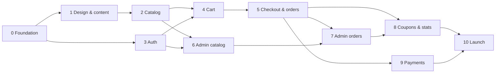

# PW Aquatics — Development Roadmap

> Status: **Approved and in progress.** Phases 0–8 are built, Phase 9 (payments) is built
> apart from going live, and the SEO part of Phase 10 was brought forward (see the progress
> table). Work starts on the owner's go-ahead; each step ends with a demo and review.

Related: [ARCHITECTURE.md](ARCHITECTURE.md) · [DATABASE.md](DATABASE.md) · [API.md](API.md)

---

## Principles

- **Vertical slices.** Each phase delivers working backend + frontend + tests
  for its features, not "all backend first".
- **Always runnable.** `docker compose up` works at the end of every phase.
- **Definition of done** for every feature: server-side validation, migrations,
  tests (unit + integration + API), typed frontend integration, responsive UI,
  accessibility check, docs updated (see AGENTS.md).
- **Small pull requests** per feature within a phase.

---

## Progress

| Phase | Frontend | Backend |
|---|---|---|
| 0 Foundation | ✅ Vite/React/TS app, Tailwind, router, API client, i18n, tests, lint, Dockerfile, CI | ✅ Spring Boot 4.1/Java 25, Flyway baseline, CSRF, Problem Details, outbox + email worker, rate limiting, Testcontainers + ArchUnit tests, Docker Compose, CI |
| 1 Brand & content pages | ✅ design tokens, UI primitives, Home, About, Gallery, Contact, legal shells, 404; design refresh: rewritten Home and About (EN/DE) without template patterns, motion system (tokens, sliding markers, sheets and dialogs that open from their trigger, add-to-cart arc, shared-element lightbox, masked reveals), reduced motion respected | ✅ `POST /contact` (validation, honeypot, rate limit) + `contact_messages` + email to shop inbox |
| 2 Public catalog | ✅ shop with URL-synced filters (category, species, colour, grade, price, availability, search, sort, paging), product page, species page, featured products on home, JSON-LD | ✅ catalog schema, search with facet counts, product/related/taxonomy endpoints, Markdown sanitising, dev demo data, OpenAPI → generated TS types |
| 3 Authentication & accounts | ✅ sign in, register, email confirmation, forgot/reset password, route guard, account overview, address book, profile & security (email, password, delete account) | ✅ users, sessions in PostgreSQL, Argon2id passwords, email verification, password reset, lockout + rate limits, no account enumeration, profile, addresses, account anonymisation, audit log, first-admin bootstrap |
| 4 Shopping cart | ✅ add to cart on the product page, cart drawer, cart page with quantity steppers, stock warnings, header badge; checkout button disabled until Phase 5 | ✅ carts for guests (HttpOnly cookie, hash stored) and customers, merge after sign-in, server-side prices/totals/VAT (`pricing`), stock limits, automatic quantity correction with warnings, daily cleanup of expired guest carts |
| 5 Checkout & orders | ✅ three-step checkout (address → shipping → review with mandatory confirmations), order button „Zahlungspflichtig bestellen“, confirmation page with bank details, order history, order detail with status timeline and cancel | ✅ shipping methods per country with dispatch weekdays and shipping pause, quote, order placement in one transaction (cart and product locks, idempotency key, price check), stock ledger, order lifecycle, bank-transfer instructions, confirmation and cancellation emails, customer cancel, expiry of unpaid orders |
| 6 Admin I: catalog & inventory | ✅ separate admin area (own layout, lazy chunks, admins only): product list with search/filters, product editor (details, Markdown with preview, colours, SEO), pack sizes with prices, photo manager (upload, drag/arrow reorder, alt texts), publish/archive/duplicate, stock overview with low/sold-out filters, stock changes and stocktake, stock history, categories, species with care data and trade restriction, colours, grades | ✅ admin APIs for products, pack sizes, photos, taxonomy and stock; photo processing to WebP renditions (content sniffing, size limits, EXIF orientation, metadata stripped); publish rules; optimistic locking for edits with stock outside it; stock corrections through the ledger; audit log of every admin write; ADMIN checked at URL and method level |
| 7 Admin II: orders & fulfilment | ✅ order list with search, status/payment/date filters and work queues (awaiting payment, to ship), order page with next step, history, notes, parcels and card-payment details; mark paid, packing, ship with tracking number, delivered, cancel with or without restock; printable packing slip; tracking links on the customer's order page; customer list and page with spend, lock/unlock; contact inbox; gallery manager (upload, alt text, publish, reorder) with the public gallery reading it; shipping methods and dispatch days; shipping pause with a banner on every shop page | ✅ `shipments`, `order_notes`, `gallery_images`; admin order API with server-decided next steps, state machine and audit log, bank transfers marked paid (card orders only by Stripe), shop cancellation with optional restock, carriers with tracking URL templates, "payment received"/"being prepared"/"shipped"/"delivered"/"cancelled" emails; customer read model and account lock that ends sessions; gallery and inbox APIs; shipping-method and pause admin with `GET /shop-info` |
| 9 (part) Card payments (Stripe) | ✅ choice of card or bank transfer in the review step, payment page with Stripe's Payment Element (cards; Apple Pay/Google Pay where offered; 3-D Secure), clear decline messages, "pay now" on the order page until the deadline, confirmation page that waits for Stripe's confirmation, EN/DE | ✅ `payments` and `payment_webhook_events`, one PaymentIntent per order from the stored total, signed and idempotent webhook (`succeeded`, `processing`, `payment_failed`, `canceled`, `charge.refunded`), payload reduced before storing, 60-minute expiry that cancels the PaymentIntent first, "payment received" email, refunds recorded, tested with real test-mode payments |
| 9 (part) PayPal | ✅ PayPal as a third choice in the review step, the same payment page with PayPal's button (PayPal's window in the shop's language; cards stay with Stripe), "choose another way to pay" when PayPal declines, "pay with PayPal" on the order page and in the email until the deadline, confirmation page that waits for the server, EN/DE; CSP for PayPal hosts | ✅ PayPal Orders v2 through the JDK HTTP client (no SDK): one PayPal order per shop order from the stored total, capture by the server (the server's answer from PayPal decides), webhooks confirmed by PayPal (`CHECKOUT.ORDER.APPROVED`, `PAYMENT.CAPTURE.COMPLETED`/`PENDING`/`DENIED`/`DECLINED`/`REFUNDED`/`REVERSED`), payload reduced before storing, same 60-minute expiry, refunds recorded; tested against a fake PayPal and a local stand-in for PayPal's API (PayPal sandbox not reachable from the build environment) |
| 9 (part) Admin refunds | ✅ "Refund" on the admin order page for card and PayPal payments: the amount left to refund is filled in and can be lowered for a partial refund, internal reason, optional message and email to the customer, the provider's reason when it refuses, list of refunds with status (refunded, on its way, failed) and who made them; EN/DE | ✅ `payment_refunds`, refunds through Stripe's Refunds API and PayPal's capture refund with the request's idempotency key, amount checked under the order and payment locks against what is left and what the owner saw, counted when the provider accepts it, `refund.updated`/`refund.failed` and `PAYMENT.CAPTURE.REFUNDED` finish or take back a refund (shop inbox told when one fails), refund email, audit log; tested with fakes for both providers and with a real Stripe test-mode refund behind Caddy |
| 3 (addition) Sign in with Google | ✅ "Continue with Google" on the sign-in and registration pages (shown once the owner sets it up), messages when Google sign-in did not work, account page shows the connected Google account with "disconnect" (while there is a password) and "email me a link" to set a password; changing the email address and deleting the account confirm with Google instead of a password; EN/DE | ✅ `user_identities` (Google's subject id), OpenID Connect code flow with PKCE run by the server (Spring Security's OAuth 2 client parts), automatic linking only for addresses Google has verified (with a notice email), unconfirmed accounts lose their password when linked, administrators password-only, confirmation with Google for 10 minutes and one change; tested against a local stand-in for Google that signs real ID tokens, and in a browser behind Caddy up to Google's sign-in page (which accepted the request and only rejected the placeholder client id; the server's code exchange with Google is not reachable from the build environment). Apple: later, same flow (ADR-014) |
| 8 Coupons & statistics | ✅ coupon field in the cart summary (apply, remove, the server's reason when a code does not or no longer applies), discount in the cart, checkout, confirmation, order pages and emails; admin coupon list with status tabs, coupon dialog (percent or euros typed as „12,5“), coupon page with what it brought, orders that used it, switch on/off, delete while unused; coupon section on the dashboard. Dashboard: right-now tiles (awaiting payment, to ship, low stock, sold out), period filter (presets and custom), key figures compared with the previous period, sales over time (paid vs. awaiting payment; revenue, orders, animals), best sellers, revenue by category/species/country, orders by weekday and status, stock changes with loss rate, latest orders, running-low list, table view for every chart, CSV download | ✅ `coupons`, `coupon_redemptions`, `carts.coupon_id`; coupon terms in `pricing` (percentage with cap, fixed amount, free shipping; minimum order; reduced products excluded; largest-remainder allocation, VAT per rate after the discount); validity in `coupon` (dates, active, total and per-customer limits); redemption in the order transaction with a conditional counter update, released on cancellation; admin coupon API with audit log; read model in `admin` (`/admin/dashboard`, `/admin/stats/{sales,products,stock,coupons}`, coupon usage and redemptions, CSV export), periods in shop time with automatic day/week/month buckets, tested against hand-counted data |
| 10 (part) SEO, brought forward | 🚧 step 1 ✅ German links: every page also under `/de/…` (same path words), language switch as links to the same page, canonical and `hreflang` per page, returning German visitors land on `/de/`, `robots.txt` for both languages. Step 2 ✅ German texts in the admin next to the English ones (products, pack sizes, photo descriptions, categories, species, colours, grades, shipping methods, gallery, coupon notes); German pages show them and fall back to English; a German product or species page stays out of Google (`noindex`) until its German text is written. Step 3 ✅ public pages (home, shop, categories, products, species, gallery, about, contact) arrive with their title, description, language links, structured data and text before JavaScript runs; the app takes over without a loading state. Step 4 ✅ `sitemap.xml` in both languages, `robots.txt` names it, each page of the shop list is its own page (`?page=2`), filtered views point to the plain list, structured data (product with a price per pack size, breadcrumbs, shop name and logo) comes from the backend. Open for launch: return policy and shipping in the product data (after the legal texts), Search Console | ✅ step 1: email links in the customer's language (`SiteLinks`). Step 2 ✅ `…_de` columns, API answers in the request's language (`ContentLanguage`), search in both languages, `languages` on product and species details, orders keep names in the customer's language. Step 3 ✅ `pages` module: Caddy asks `GET /_pages/**`, the backend fills the frontend build's `index.html` (head, text, first API responses), 404 for unknown addresses, products, species and categories (the app’s route list comes with the build), plain `index.html` as fallback (ADR-013). Step 4 ✅ `GET /_site/sitemap.xml` and `/_site/robots.txt` (Caddy serves them as `/sitemap.xml`, `/robots.txt`), `?page=N` on shop pages, structured data only from the backend (`Product` with `Offer` per pack size, `BreadcrumbList`, `Organization`, `WebSite`) |

Open in Phase 7: a packing slip as PDF (with invoices in Phase 10; the print page covers it
until then), the audit-log page, the orders CSV export, the real carrier list and tracking
URLs (DHL and DHL Express are preset), linking gallery photos to species.
Open in Phase 6: real product photos and texts (entered by the owner in the admin), the
owner's own administrator account (`APP_ADMIN_BOOTSTRAP_*` on first start), image storage
outside the server (S3) if wanted.
Open in Phase 8: the owner's decisions on the coupon defaults (one code per order, whole
shop, reduced products excluded, free shipping for every method — ARCHITECTURE.md §12);
coupons limited to categories or products, combinable codes and first-order-only codes if
wanted; a German/English text for the coupon's note (the note is shown as entered).
Open in Phase 5: real shipping prices (the dev seed has placeholders; production has no
shipping methods until they are entered), the shop's bank account (`BANK_*`), final
checkout wording and legal texts, VAT treatment of deliveries outside Germany, public
holidays in the dispatch calendar.
Phase 1 brand applied: PW Aquatics logo, white + baby-blue scheme, English default.
Open in Phase 2: real product photos (uploads arrive with the admin in Phase 6), owner review of species data and product copy, CI check that generated API types are up to date.
Open in Phase 1: owner approval of the visual direction, photography, final copy and the real contact email.
No cookie banner so far: the shop sets only essential cookies, and Stripe's and PayPal's scripts load only on the payment page once the customer has chosen that way to pay, which we treat as necessary for the service the customer asked for (to be confirmed with the legal texts; the privacy policy must name Stripe and PayPal). A banner becomes necessary with analytics or marketing tools.

## Phase overview

| Phase | Name | Main outcome |
|---|---|---|
| 0 | Foundation | Repo skeleton, Docker Compose, CI, empty but running apps |
| 1 | Brand, design system & content pages | The site looks like PW Aquatics; Home, About, Gallery (static), Contact |
| 2 | Public catalog | Shop with filters, product and species pages, seed data |
| 3 | Authentication & accounts | Register, login/logout, verification, password reset, profile, addresses |
| 4 | Shopping cart | Persistent guest/customer cart with merge on login |
| 5 | Checkout & orders | Order placement with bank transfer, emails, order history & status |
| 6 | Admin I — catalog & inventory | Admin shell, products, images, taxonomy, stock management |
| 7 | Admin II — orders & fulfilment | Order management, status changes, tracking numbers, customers, gallery, contact inbox, shipping settings |
| 8 | Coupons & statistics | Coupons end-to-end, dashboard and sales statistics |
| 9 | Payments | Stripe (cards, Apple Pay, Google Pay), PayPal, webhooks, refunds |
| 10 | Launch readiness | SEO prerendering, legal, invoices, security & performance audits, production deployment |
| 11 | Post-launch | Improvements based on real usage |

A **soft launch** with bank transfer (Vorkasse) only is technically possible
after Phase 8 + the legal/security parts of Phase 10, if the owner wants to
start selling before card payments are ready.

---

## Phase 0 — Foundation

**Goal:** a clean, running skeleton with all tooling in place.

- Monorepo layout (`backend/`, `frontend/`, `infra/`, `docs/`).
- Backend: Spring Boot project (Gradle), packages per module, `common` kernel
  (Money, Problem Details handler, base entity, UUIDv7 IDs, Clock), Actuator,
  springdoc, Flyway with first migration (extensions, `shedlock`, `outbox_messages`),
  profiles `dev`/`test`/`prod`, Testcontainers base test, ArchUnit boundary test.
- Frontend: Vite + React + TypeScript (strict), Tailwind, React Router, TanStack
  Query, API client with CSRF handling, OpenAPI type generation script,
  ESLint + Prettier, Vitest.
- Docker: multi-stage Dockerfiles (non-root), `docker-compose.yml` with
  postgres, backend, mailpit; Vite proxy for `/api` and `/media`.
- `.env.example`, `.gitignore`, `.editorconfig`, README with setup instructions.
- GitHub Actions: build, test, lint, type-check, OpenAPI drift check, Docker build.
- Dependabot.

**Done when:** `docker compose up` starts DB + API; `npm run dev` shows a
placeholder page that calls `/api/v1/health`; CI is green.

## Phase 1 — Brand, design system & content pages

**Goal:** establish the premium look before building shop features.

- Design tokens in Tailwind `@theme`: colour palette, typography scale,
  spacing, radii, shadows, motion durations.
- Self-hosted fonts.
- UI primitives (`components/ui`): Button, Input, Select, Checkbox, Badge,
  Dialog, Drawer, Toast, Skeleton, ResponsiveImage, Price, EmptyState.
- Layout: header with navigation and cart icon, mobile menu, footer
  (legal links, contact), cookie consent banner.
- Pages: Home (hero, featured section placeholders, brand story teaser),
  About, Gallery (static images for now), Contact (form → `POST /contact`
  with rate limit + honeypot + `contact_messages` table + notification email),
  legal page shells, 404 page.
- i18n setup (English default, German second).

**Owner input needed:** logo, brand colours approval, photography, about-us text.

**Done when:** pages are responsive, pass Lighthouse accessibility ≥ 95, and
the owner approves the visual direction.

## Phase 2 — Public catalog

**Goal:** customers can browse and filter the full assortment.

- Migrations: categories, species, colours, grades, products, product_colours,
  product_variants, product_images, stock_movements.
- Catalog module: read services, JPA Specifications for filters, facet counts,
  availability derivation, text search (`pg_trgm`), slug handling.
- Media module: storage abstraction (local disk first), image rendition URLs.
- Endpoints: `/products`, `/products/facets`, `/products/{slug}`,
  `/products/{slug}/related`, `/categories`, `/species`, `/species/{slug}`,
  `/colours`, `/grades`.
- Dev seed data: realistic species, products, variants and images.
- Frontend: Shop page (filter panel, chips, sorting, pagination, URL-synced
  filters, mobile filter drawer), ProductCard, Product page (gallery, variant
  selector, care table, availability), Species page, homepage featured products.
- Per-route meta tags and JSON-LD `Product`.

**Done when:** all five required filters (species, colour, grade, price,
availability) work in any combination, results are correct in integration tests,
and product pages render with real seed data.

## Phase 3 — Authentication & accounts

**Goal:** secure customer accounts.

- Migrations: users, user_tokens, addresses, Spring Session tables, audit_log.
- Spring Security: session auth, CSRF cookie-to-header, password encoder,
  login rate limiting and lockout, role model, method security.
- Endpoints: `/auth/*`, `/account/profile`, `/account/password`,
  `/account/email`, `/account/addresses`, `DELETE /account`.
- Transactional emails via outbox: verification, password reset, password changed.
- Admin bootstrap: first admin created from environment variables on startup
  if no admin exists.
- Frontend: login, register, verify email, forgot/reset password, account
  layout, profile, address book; `RequireAuth` / `RequireAdmin` guards.

**Done when:** security tests pass (CSRF required, session rotation, no account
enumeration, IDOR on addresses returns 404, lockout works).

Added later (owner's request, 2026-11-17): ✅ Sign in with Google (ADR-014). Go-live: an OAuth
client ("Web application") in the Google Cloud console with the shop's redirect URI, the consent
screen published with the shop's name, logo, privacy policy and terms links, privacy policy
names Google. Sign in with Apple: when the shop has its domain and an Apple Developer account.

## Phase 4 — Shopping cart

**Goal:** a persistent cart that never trusts the client.

- Migrations: carts, cart_items.
- Pricing module (first version): line totals, subtotal, included VAT.
- Guest cart cookie, customer cart, merge on login, cleanup job for expired guest carts.
- Endpoints: `/cart`, `/cart/items`.
- Frontend: add-to-cart from product page, cart drawer, cart page, warnings display.

**Done when:** cart survives logout/login and browser restarts, merge
edge cases are tested, manipulated requests cannot change prices.

## Phase 5 — Checkout & orders

**Goal:** customers can place real orders (bank transfer) and follow them.

- Migrations: shipping_methods, shipping_method_countries, shop_settings,
  orders, order_items, order_addresses, order_status_history, order number sequence.
- Shipping module: methods per country, dispatch weekday rules, next dispatch
  date calculation, shipping pause setting.
- Order module: quote, placement transaction with locking and idempotency,
  stock movements, state machine, expiry job for unpaid orders (returns stock).
- Bank-transfer payment provider (payment instructions).
- Emails: order confirmation (with bank details), order cancelled.
- Endpoints: `/checkout/*`, `/account/orders`, `/account/orders/{orderNumber}`,
  customer cancel.
- Frontend: multi-step checkout (address → shipping → review with mandatory
  checkboxes → "Zahlungspflichtig bestellen"), confirmation page, order history,
  order detail with status timeline.

**Done when:** the concurrency test (two buyers, last animal) passes, duplicate
submissions create one order, price change between quote and order is caught.

## Phase 6 — Admin I: catalog & inventory

**Goal:** the owner manages the assortment without developer help.

- Admin layout (lazy-loaded), navigation, data tables with search/sort/paging.
- Product editor: details, Markdown description with preview, species/category/
  grade/colours, SEO fields, variants table, publish/archive/duplicate.
- Image manager: upload with processing (resize, WebP, EXIF stripping),
  drag-to-reorder, alt texts.
- Taxonomy management: species (incl. care data and trade restriction),
  categories, colours, grades.
- Inventory: stock overview, low-stock filter, adjustments (restock, loss,
  correction), stocktake, movement history.
- Audit logging of all admin writes.

**Done when:** a new product can be created, photographed, published and
stocked entirely through the admin UI; non-admins get 403 on every admin endpoint.

## Phase 7 — Admin II: orders & fulfilment ✅

**Goal:** the owner can process orders end-to-end.

- Migrations: shipments, order_notes, gallery_images.
- Order management: list with filters, detail, mark as paid, status changes
  (state machine), cancellation with restock, internal notes, packing slip
  (built as a print page; the PDF follows with invoices in Phase 10).
- Tracking: add/edit shipments with carrier + tracking number; carrier
  tracking URL templates; "shipped" email with tracking link.
- Customer tracking view in the account area.
- Customers: list, detail, lock/unlock.
- Content: gallery manager (replaces static gallery), contact message inbox.
- Settings: shipping methods, dispatch weekdays, shipping pause banner.

**Done when:** an order can go from placed → paid → processing → shipped →
delivered via the admin, and the customer sees each step and the tracking link.

## Phase 8 — Coupons & statistics ✅

**Goal:** marketing tools and business insight.

- ✅ Migrations: coupons, coupon_redemptions, carts.coupon_id.
- ✅ Coupon rules in the pricing module (percentage, fixed amount, free shipping;
  dates, minimum order, usage limits total/per customer, max discount),
  proportional discount allocation for VAT.
- ✅ Cart and checkout coupon support; redemption recorded atomically with the order.
- ✅ Admin coupon management and redemption list.
- ✅ Dashboard: KPI cards, revenue chart, orders by status, low stock, recent orders
  (built early at the owner's request, together with the statistics below).
- ✅ Statistics: sales over time, top products, revenue by category/species/country,
  orders by weekday, stock changes and loss rate, coupon performance, CSV export.

**Done when:** coupon edge cases (expired, limit reached concurrently, minimum
not met, rounding) are covered by tests; dashboard numbers match a manual check.
✅ Tested: `DiscountCalculationTest` (rounding, caps, reduced lines, allocation, VAT per
rate, free shipping), `CouponTest` (status and problems), `CouponApiTest` (expired,
minimum not met, once per customer, release on cancel, two customers racing for the last
use → one order, one `COUPON_USAGE_LIMIT_REACHED`), `AdminCouponApiTest`; the coupon
figures on the dashboard were compared with a count straight from the order tables.

## Phase 9 — Payments

**Goal:** online payment with all requested methods.

- ✅ Payment module: `payments` and `payment_webhook_events` tables (ADR-010).
- ✅ Stripe: PaymentIntent created from stored order total, Payment Element
  (cards, Google Pay, Apple Pay once the domain is verified), 3-D Secure,
  webhook handling (`payment_intent.succeeded`, `payment_failed`, refunds).
- ✅ Order expiry for abandoned card payments (`ORDER_CARD_PAYMENT_MINUTES`, default 60).
- ✅ Test-mode payments verified locally (success, decline, 3-D Secure) with real Stripe
  events delivered to the webhook.
- Stripe go-live: register the webhook endpoint in the Dashboard, verify the domain for
  Apple Pay, CSP for Stripe hosts, privacy policy names Stripe; staging verified with test cards.
- ✅ PayPal: Orders API create/capture, webhook verification (ADR-010 addendum).
- PayPal go-live: a sandbox payment end to end behind Caddy (CSP), webhook registered for the
  live REST app, live credentials with `PAYPAL_ENVIRONMENT=live`, privacy policy names PayPal.
- ✅ Admin refunds (full/partial) through Stripe or PayPal from the admin order page, with an
  idempotency key, a check against what the owner saw, an optional email to the customer, and
  webhooks for pending and later-failed refunds (ADR-010 addendum). Bank transfers are paid
  back by hand. Go-live: add `refund.updated` and `refund.failed` to the Stripe webhook.

**Done when:** an order is marked paid only by a verified webhook, duplicate
webhooks are harmless, no card data is stored or logged anywhere.

## Phase 10 — Launch readiness

**Goal:** a secure, legally compliant, fast production shop.

- **SEO** (brought forward at the owner's request, see the progress table; ADR-012): German
  links under `/de` ✅, German catalog texts ✅, public pages (home, shop, categories, products,
  species, content) filled in by the existing backend per request — no extra server — ✅,
  `sitemap.xml` ✅, `robots.txt` ✅, canonical URLs ✅, structured data ✅ (return policy and
  shipping details once the legal texts are final). At launch: real domain, Google Search
  Console, sitemap submitted, Rich Results test.
- **Legal (with lawyer/legal-text service):** Impressum, privacy policy,
  terms (AGB), withdrawal policy incl. live-animal specifics, shipping and
  live-arrival conditions, checkout wording, price display. No cookie banner is
  needed while the shop only sets strictly necessary cookies (docs/DATABASE.md §6).
- **Data protection (owner, with adviser):** record of processing activities
  (GDPR Art. 30, based on docs/DATABASE.md §6), data processing agreements (Art. 28)
  with the hosting, email and backup providers, a UK representative (UK GDPR Art. 27)
  while selling to UK customers, a process for data subject requests and data
  breaches (72-hour notification, Art. 33), and the order retention period with the
  tax adviser (then build the order anonymisation job).
- **Invoices:** sequential invoice numbers, PDF invoices attached to emails,
  downloadable in the account.
- **Security:** OWASP Top 10 review, dependency audit, CSP finalised,
  admin TOTP two-factor authentication, penetration test (at least an automated
  scan with OWASP ZAP).
- **Performance:** Lighthouse ≥ 90 on mobile for key pages, image CDN/caching
  headers, database index review with realistic data.
- **Accessibility:** WCAG 2.2 AA audit, keyboard and screen-reader testing.
- **Operations** ✅ (brought forward): production Compose with an edge Caddy (automatic HTTPS,
  HSTS), nightly backups of database and photos with a restore command tested in CI, `/health`
  for uptime monitoring and a heartbeat per backup, log rotation (5 × 10 MB, no access log, no
  personal data), Dependabot, and the runbook `docs/OPERATIONS.md` (server, first start,
  SPF/DKIM/DMARC, payments go-live, backups off the server, updates, incidents, go-live
  checklist). At launch: the server, the mail provider's DNS records, an uptime monitor and the
  off-site backup copy, set up by following the runbook.
- Final end-to-end test suite run on staging; owner acceptance test.

**Done when:** owner signs off and the go-live checklist is complete.

## Phase 11 — Post-launch (backlog, prioritised with the owner)

Guest checkout · back-in-stock notifications · wishlists · product reviews ·
newsletter (double opt-in) · tiered pricing ·
carrier API integration (labels, automatic tracking status) · care guides / blog ·
loyalty programme.

---

## Dependencies between phases

Phases 2 and 3 can run in parallel; Phase 6 can start as soon as 2 and 3 are done.

---

## Decisions needed before Phase 0

See the open questions in [ARCHITECTURE.md §12](ARCHITECTURE.md#12-open-questions-for-the-owner).
The ones that block early phases:

1. Gradle or Maven (default: Gradle) and root package name (default: `com.pwaquatics.shop`).
2. Languages at launch (affects Phase 1 setup).
3. Grade scale design (affects Phase 2 schema).
4. Whether exact stock counts are public (affects Phase 2 API).
5. Shipping countries and carrier for live animals (affects Phase 5).
